# ElatedQuest: Product and Build Specification

Version 2.27 · 12 November 2026 · Written for AI coding agents (Claude Code, OpenAI Codex) and developers.

## Contents

- 1. How to use this document
- 2. Product overview and study of auxx.me
- 3. Technical architecture
- 4. Data model (MySQL)
- 5. Roles, sign-in and access control
- 6. Public pages
- 7. Admin pages  ( /aadmin )
- 8. Feature specifications
- 9. Routes and API reference
- 10. Security requirements
- 11. Operations, performance and legal
- 12. Build plan (milestones)
- 13. Launch checklist
- 14. After launch (backlog)
- Appendix A. Reserved slugs
- Appendix B. MySQL schema (database/schema.sql)

## 1. How to use this document

This is the single source of truth for the website. Every page, rule, table and milestone is written here so a developer or an AI coding agent (Claude Code, OpenAI Codex) can build without guessing. **Version 2.0** changes the stack to Node.js + MySQL + vanilla HTML/CSS/JavaScript, adds the interaction features studied on auxx.me, and removes all subscription features.

### 1.1 Working method

1. Create the project folder, put this spec in `docs/SPEC.md`, the wireframes in `docs/wireframes/`, and the SQL files in `database/`. All are in the spec pack. Agents read Markdown more reliably than Word.
2. Copy the agent rules (1.2) to `AGENTS.md` (Codex) and `CLAUDE.md` (Claude Code). Both are in the pack.
3. Create the database in MySQL Workbench with `database/schema.sql`, then `database/seed.sql` (section 4.1).
4. Build one milestone at a time (section 12). Paste its agent prompt, then tick its “Done when” list before moving on.
5. When a requirement changes: edit the spec first, add a row to the change log (1.3), then tell the agent which section changed. For database changes also add a migration file and update `database/schema.sql`.
6. The Word file and `docs/SPEC.md` must always match. Edit one, then regenerate or edit the other.

### 1.2 Agent rules (paste into AGENTS.md and CLAUDE.md)

```
# Project rules
- Source of truth: docs/SPEC.md and database/schema.sql. Build only what the spec says.
  Read section 1.5 (Decisions) first: it settles open points.
- Stack: Node.js + Express, Nunjucks templates, plain CSS, vanilla JavaScript (ES modules),
  MySQL 8 via mysql2. No front-end framework, no ORM, no bundler.
- Layers: routes -> controller -> service -> repository. SQL lives ONLY in repository.js
  files and is always parameterized (?). Never build SQL from strings.
- One feature = one folder in src/modules/<feature>/. Other modules call its service,
  never its repository. Shared code in src/lib/ must know nothing about a feature.
- Browser code: one small ES module per feature in public/js/features/, started by a
  data-feature attribute. No inline scripts. Pages must still work without JavaScript.
- Database change = new numbered file in src/db/migrations/ + update database/schema.sql.
- Security is mandatory: every /aadmin page and admin API route calls requireRole()
  itself. Secrets live only in .env. Sanitize post HTML on the server before saving.
- Public pages never show drafts, in-review, scheduled or archived posts.
- If code and spec disagree or the spec is unclear, stop and ask. One milestone at a time.
- Before saying done: run npm run lint and npm test, then list every "Done when" item as
  PASS or FAIL with how you tested it.
- Ask before adding a dependency. Small commits with clear messages.
```

### 1.3 Change log

| Version | Date | Change | Sections |
| --- | --- | --- | --- |
| 2.27 | 12 Nov 2026 | Widen the desktop homepage composition to match the supplied reference while retaining Elated Quest branding, configured content, consent rules, and mobile/tablet layouts. | 6.1 |
| 2.26 | 7 Nov 2026 | Fill the 18-card People Also Read layout by cycling available published posts; new published posts replace repeated fillers. | 6.1 |
| 2.25 | 7 Nov 2026 | Add a consent-gated 324×250 homepage sidebar promoted-content placement beneath Stay Connected; no database migration, uses existing social settings and ad configuration. | 6.1, 8.12 |
| 2.24 | 7 Nov 2026 | M8 ads settings, four reserved placements, consent gating, lazy loading, CSP, owner placeholders and generated ads.txt completed and verified. | 8.12, 12 |
| 2.23 | 7 Nov 2026 | M6 tabs, reader submissions, contact messages, social and menu editor, saved stories and random-story routes completed and verified; M8 Ads next. | 6.1, 6.5, 8.5, 8.9–8.11, 12 |
| 2.22 | 7 Nov 2026 | M5 comments, ratings, votes, share/save controls and A9 moderation completed and verified; M6/M8 remain next. | 6, 8.5–8.8, 12 |
| 2.21 | 7 Nov 2026 | Homepage scope expanded by owner to match Auxx composition, including M6 People Also Read/social rail and M8 ad slots; execute M5, M6, then M8 sequentially. Retain Elated Quest brand and content. | 6.1, 6.5, 12 |
| 2.20 | 7 Nov 2026 | Homepage geometry, card metadata placement and editorial footer align to measured Auxx layout while retaining Elated Quest data and M4 scope. | 6.1, 6.5 |
| 2.19 | 7 Nov 2026 | Homepage wireframe alignment targets and public page cache development switch. | 3.3, 6.1, 6.5 |
| 2.18 | 7 Nov 2026 | Public display name is “Elated Quest”; the internal app and database identifier remains `elatedquest`. | 2.3, 6 |
| 2.15 | 5 Nov 2026 | M4 foundation: add public site layout, shared site data and static-page routing. | 6, 9, 10.2 |
| 2.16 | 5 Nov 2026 | M4 content pages: home, post, category, tag, author and search routes, reusable public cards, pagination and sidebar blocks. | 6, 9, 10.1 |
| 2.17 | 7 Nov 2026 | M4 behavior: public view counter, rendered-page cache and invalidation, and public-template admin preview. | 3.3, 6, 9, 10.2 |
| 2.14 | 5 Nov 2026 | M3 final review: make the About page author visibility column an additive migration. | 1.5, 4.3 |
| 2.13 | 5 Nov 2026 | Owner can manually sync an already-published post after connecting Blogger. | 7.2, 7.3, 8.4 |
| 2.12 | 5 Nov 2026 | M3 stabilization: role display labels, Blogger sync, post image sizing, and sidebar scrolling. Stored authorization role IDs stay `owner`/`editor`. | 1.5, 5, 7.3, 7.6, 8.4, 12 |
| 2.11 | 4 Nov 2026 | Added shared admin design tokens, form, button, and table conventions with contrast checks. | 3.7 |
| 2.10 | 4 Nov 2026 | Added dashboard post suggestions and clarified editor image, sidebar, and upload behavior. | 7.2, 7.3, 7.4, 9 |
| 2.9 | 4 Nov 2026 | Owner can republish an edited published post; its published status and original publish date remain. | 1.5, 8.1 |
| 2.8 | 3 Nov 2026 | A3 toolbar has no table button; the Quill core build does not provide one. | 7.3 |
| 2.7 | 3 Nov 2026 | Added owner-only Categories admin page (A13). | 7.13 |
| 2.6 | 2 Nov 2026 | Added `authors.show_on_about` for team visibility on About Us. | 4.3, 6.6, 7.12 |
| 1.0 | 28 Oct 2026 | First complete specification (Next.js, PostgreSQL). | All |
| 2.5 | 31 Oct 2026 | Decision 8 added to section 1.5: application field limits versus database headroom. | 1.5 |
| 2.4 | 31 Oct 2026 | Database renamed from blog_platform to elatedquest (lowercase, see 4.1). | 3.8, 4.1 |
| 2.3 | 30 Oct 2026 | Initial product name was ElatedQuest. Public branding now uses “Elated Quest”; `elatedquest` remains the internal app and database identifier. | Public site, 3.8, 6 |
| 2.2 | 30 Oct 2026 | Settled 7 open points from the first agent review (new section 1.5): owner link, title limits, routing, emails, email comparison, post actions, migrations. | 1.5, 4, 5, 8, 12 |
| 2.1 | 30 Oct 2026 | Merged with the reviewed v1.1 file: Nunjucks templates, empty extension slots, Saved stories and Surprise me; no comment website field; no share counter; Comments and Stories in one Inbox page. | 3, 6, 7, 8 |
| 2.0 | 29 Oct 2026 | Node.js + MySQL + vanilla stack; ER diagrams and SQL; auxx.me study; comments, ratings, sharing, author pages, social links, menus, About, Contact (messages and stories), DMCA, Image Use, Join Us; all subscription features removed. | All |

### 1.4 Assumptions and open decisions

| # | Topic | Default used in this spec | Change it if… |
| --- | --- | --- | --- |
| 1 | Stack | Node.js + Express, Nunjucks, plain CSS, vanilla JS, MySQL 8 (your choice) | Never mind: this is now fixed by you. Only Nunjucks (server-side HTML templates) is added, because search engines need server-rendered HTML. |
| 2 | Main copy of posts | Own site is the main copy; Blogger receives a mirror. | Blogger must stay the main source: rewrite 8.4 and the post tables. |
| 3 | Ad network | Google AdSense | Another network: use the “custom” provider (8.12). |
| 4 | Editors publishing | Editors submit for review; owner approves. A setting allows direct publishing. | You trust editors fully: switch the setting on. |
| 5 | Comments | Moderated: first-time commenters wait for approval. | Change the mode in Settings → Rules. |
| 6 | Reader stories | Part of the Contact Us page: a form that emails the editors and stores the story for review; the plain email address is also shown. | You want email only: hide the form, keep the address. |
| 7 | Reference site | auxx.me is a model for structure and interaction only. Use your own name, logo, text and images. | — |
| 8 | Hosting | Any Linux VPS or Node host + MySQL 8 + Nginx + PM2 | Managed host: replace PM2/Nginx notes in section 11. |
| 9 | Subscriptions | None: no newsletter, no comment-reply emails, no subscribers table. | Re-adding later is a new module (section 14). |

### 1.5 Decisions (settled, apply everywhere)

| # | Topic | Decision |
| --- | --- | --- |
| 1 | Owner link | Tokens are created only by `npm run owner-link` on the server. The web route `/auth/owner-link` only redeems a valid token (hashed in `login_tokens`, 10 minutes, single use, rate limited). |
| 2 | Title limits | 120 characters for post titles and story titles, set once in `src/config/constants.js`. The database columns (160 and 200) stay as headroom. |
| 3 | Routing of /{slug} | Lookup order: reserved slugs and fixed routes, then posts, then pages, then redirects, then 404. Pages cannot be created in the UI, so conflicts come only from posts: creating or renaming a post must reject a reserved slug or any `pages.slug`. The check lives in `src/lib/slug.js`. |
| 4 | Emails | Story submissions send a receipt to the reader. Contact messages do not (thank-you page only). |
| 5 | Email comparison | One function `normalizeEmail()` (trim + lowercase) in `src/lib/email.js` is used wherever emails are stored or compared. The first-time commenter rule compares normalized emails and counts approved comments only. |
| 6 | Post actions | submit: editor or owner, own draft → in_review. publish: owner (editor only if `editors_can_publish` is on), from draft or in_review; owner may also republish an edited published post while keeping its original `published_at`; “approve” is publish on an in_review post. reject (“Request changes”): owner only, in_review → draft, optional note up to 500 characters in `review_note`. archive: owner only. |
| 7 | Migrations | `database/schema.sql` is the Workbench script (creates the database, `IF NOT EXISTS` everywhere). `src/db/migrations/001_init.sql` is the initial schema without the `CREATE DATABASE` and `USE` lines. Later schema changes use new numbered migration files and update the Workbench script. The runner assumes the database exists, creates `schema_migrations(version, applied_at)` itself first, runs unapplied files in order and records each. Migrations that may encounter a database initialized from the current Workbench schema must safely detect already-present objects. |
| 8 | Field limits | The database columns are headroom; the application limits are the working limits. Define them once in `src/config/constants.js` and enforce them in the validators: post and story title 120 (columns 160 and 200), SEO title 60 (column 70), meta description 160 (column 170), excerpt 200 (column 300). Do not change the schema. |
| 9 | Role display names | Display `owner` as “Admin” and `editor` as “Content Moderator”. Keep stored role identifiers, access checks, API values, and OWNER_EMAIL behavior unchanged. |

## 2. Product overview and study of auxx.me

### 2.1 What we are building

A public blog full of reader interaction, plus a private studio at `/aadmin` for the owner and a few invited editors. Readers never create accounts but can comment, rate, vote, share and send in their own stories. Posts are written in `/aadmin`, saved in MySQL, shown on the site and optionally mirrored to Blogger.

### 2.2 Goals

- Keep readers on the site: tabs by category, “People also read…”, popular posts, editor picks, related posts, author pages.
- Let readers take part: comments with replies and votes, star ratings, sharing, and story submissions.
- Ads earn money but never block reading (no popups, no ad above the title, no layout jumps).
- Only the owner and invited editors reach `/aadmin`. No passwords.
- Good search ranking, fast pages, easy to change later (section 3.4 to 3.6).

### 2.3 Not in version 2.0

- Subscriptions of any kind (newsletter, comment-reply emails).
- Reader accounts and logins, push notifications, paid memberships.
- Multiple languages, multiple owners, video embeds.

### 2.4 Roles at a glance

| Role | Signs in? | Can do |
| --- | --- | --- |
| Reader | No | Read, search, comment, reply, vote, rate, share, submit a story, send a contact message. |
| Editor | Yes, by invitation | Write own posts, upload images, submit for review (or publish if allowed), moderate comments, review reader submissions. |
| Owner | Yes, email = OWNER_EMAIL | Everything, plus approve and publish, edit any post, team, settings, social links, menus, ads, Blogger, static pages, contact messages, audit log. |

### 2.5 What auxx.me has: pages

Studied on 29 Oct 2026 (home, a post, Submit an Article, Contact Us, Join Us, DMCA, Image Use Policy). Auxx.me is a WordPress site; we copy behavior, not code, text or images.

| Page on auxx.me | Address pattern | In v1.0? | Our decision |
| --- | --- | --- | --- |
| Home with tabs and sidebar | / | Partly | Rebuilt (P1): top bar, featured, tabbed sections, sidebar blocks. |
| Post (comments, rating, share, author box) | /{slug}/ | Partly | Extended (P2). |
| Category archive | /category/{slug}/ | Yes | Kept (P3). |
| Author page | /author/{name}/ | No | Added (P7), `/author/{slug}`. |
| About Us | /about-us/ | Basic | Own page with team row (P6), `/about-us`. |
| Contact Us | /contact-us/ | Basic | Business details + message and story form (P6), `/contact-us`. |
| Submit an Article (by email, with terms) | /submit-an-article/ | No | Merged into Contact Us (P6): a “Send a story” option with terms, plus the email address. |
| Join the Family (jobs) | /join-the-auxx-me-family/ | No | Optional `/join-us` (P7). |
| DMCA and Copyright Removal | /dmca-removal/ | No | Added (P7), `/dmca-removal`. |
| Image Use Policy | /image-use-policy/ | No | Added; plus credit fields on images (7.4). |
| Privacy Policy | /privacy-policy/ | Yes | Kept, `/privacy-policy`. |
| Search | /?s= | Yes | Kept (P3). |

### 2.6 What auxx.me has: interaction, compared with our spec

| Feature on auxx.me | Had it? | Decision | Section |
| --- | --- | --- | --- |
| Social icons in a top bar + footer | No | Added. Managed in admin (social_links). | 6.6, 8.11 |
| Top menu: policies, About, Contact | No | Added. Editable menus. | 8.11 |
| “People also read…” with category tabs | Partly | Tabs added; unread-first filter kept. | 8.5 |
| “Latest articles” with category tabs | Partly | Tabs + Load more, no page reload. | 8.5 |
| Stay Connected: follower counts | No | Added; counts typed by owner (no API). | 8.11 |
| Editor Picks, Popular Posts, Popular Categories | Partly | All three added to the sidebar. | 8.5 |
| Views and comment counts on posts | Partly | Shown on cards and posts. | 8.5 |
| Share buttons (10+ networks) | Partly | Configurable list + native Share + Save button. | 8.8 |
| Saved stories, Surprise me | No | Added (small, browser-side). | 8.17 |
| Article star rating | No | Added. | 8.7 |
| Comments: replies, votes, sorting | No (was skipped) | Added with moderation. Reply emails NOT added (no subscriptions). | 8.6 |
| Author box + author pages | No | Added. | 7.1, 8.5 |
| “You may also like” | Yes | Kept (4 cards). | 8.5 |
| Submit an article by email | No | Added inside Contact Us (no separate button). | 8.9 |
| Image credits | No | Added to media. | 7.4 |

### 2.7 What we do not copy

- No WordPress, plugins or Gravatar. Comment avatars are colored initials made locally (no third-party calls).
- No 55-category menu: keep 10 to 15 categories and use tags for detail (thin category pages hurt ranking).
- Social icons without a URL are hidden automatically. No follower numbers from third-party scripts.
- Do not copy auxx.me's articles, images, logo or wording. Write your own.

### 2.8 Decisions that changed from the first idea

| Original idea | Decision | Why |
| --- | --- | --- |
| Admin password + reset screen | Removed. Google sign-in or emailed one-time link. | Nothing to forget. |
| Client ID/secret typed into the dashboard | Moved to `.env`. | Secrets in a form are a risk. |
| Publish straight to Blogger | Save in MySQL first, then mirror to Blogger with retry. | Never lose writing. |
| Random “people also reading” | Unread-first, by category tab. | More pages per visit. |
| Comments postponed | Added (moderated). | Interaction is the top priority. |
| Newsletter and comment-reply emails | Removed completely. | Owner decision. |

## 3. Technical architecture

### 3.1 Stack

| Layer | Choice | Notes |
| --- | --- | --- |
| Runtime / server | Node.js LTS + Express | Two processes: `server.js` (web) and `worker.js` (background jobs). |
| Pages | Nunjucks templates (auto-escaping on) | Search engines get full HTML. No front-end framework. |
| Styling | Plain CSS files with CSS variables | Mobile first, BEM-style class names. `npm run build:css` joins files (tiny script). |
| Browser code | Vanilla JavaScript ES modules | One small module per feature, no bundler. |
| Database | MySQL 8.0, InnoDB, utf8mb4, `mysql2/promise` | Designed and inspected in MySQL Workbench. |
| Migrations | Numbered `.sql` files + `npm run migrate` | Tracked in a `schema_migrations` table created by the runner. |
| Sessions / auth | express-session + express-mysql-session; google-auth-library | Google OpenID Connect plus emailed one-time links. |
| Email | nodemailer (any SMTP) | Sign-in links, invite and review notices, story and contact messages. |
| Safety | helmet, csrf-csrf, sanitize-html, zod | Headers, CSRF, HTML cleaning, input validation. |
| Editor / images | Quill (self-hosted), multer, sharp | Rich text; upload; resize to WebP. |
| Jobs | node-cron inside `worker.js` | Scheduled publishing, Blogger retry, cleanup, backups. |
| Quality | ESLint, Prettier, `node --test`, supertest | Playwright for browser tests is optional. |
| Run in production | PM2 + Nginx (HTTPS) | Nginx can also cache static files. |

> **Note:** Use the latest stable versions and read each package's current documentation before wiring it in (especially google-auth-library and the Blogger API). Do not code from memory.

### 3.2 System diagram

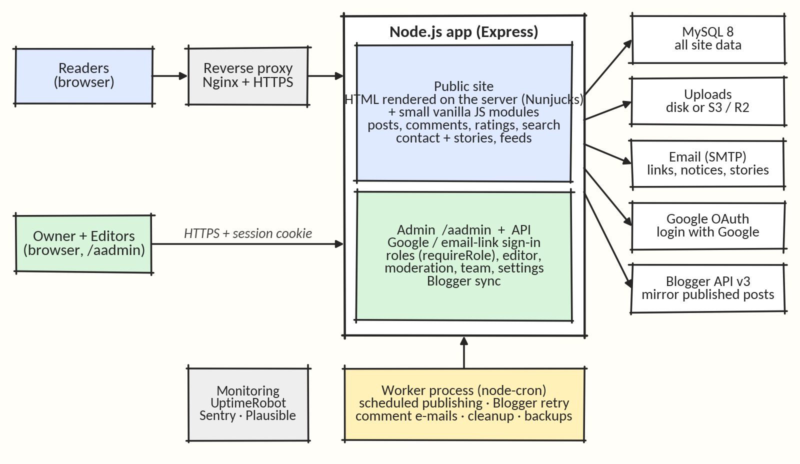

*Figure 1. System architecture*

### 3.3 Rendering and caching

- Every public page is rendered on the server. Anonymous GET pages (home, post, category, author) are kept in a small in-memory cache for 60 seconds (`src/lib/cache.js`). Publishing, editing or archiving clears the affected keys immediately.
- `/aadmin` and `/api/admin/*` are never cached: `Cache-Control: no-store`, `X-Robots-Tag: noindex`.
- View counting is a separate small POST after the page loads, so cached pages stay cached.
- `localStorage` holds only the reader's read history (for “People also read…”). Nothing personal is sent to the server.

### 3.4 Layering rules (keep the code easy to change)

1. **routes.js** only maps URLs to controller functions and lists middleware.
2. **controller.js** handles HTTP: read input, validate (validators.js), call the service, render a view or send JSON.
3. **service.js** holds the business rules. It may call other modules' services, never their repositories.
4. **repository.js** holds all SQL for that module's tables. Parameterized queries only.
5. **views** (Nunjucks) contain no business logic, only display. Reusable pieces are partials.
6. Every module exposes `registerRoutes(app)` and is listed once in `src/modules/index.js`. Adding a module = one new folder + one line there.
7. Limits and magic numbers live in `src/config/constants.js`, never inside code.

### 3.5 Project structure

```
elatedquest/
  server.js                 starts the web app
  worker.js                 starts background jobs
  package.json  .env.example  AGENTS.md  CLAUDE.md
  database/                 schema.sql  seed.sql  er-core.png  er-interaction.png
  docs/                     SPEC.md  wireframes/  RESTORE.md  ADDING-A-FEATURE.md
  scripts/                  owner-link.js  backup.sh  recount.js
  src/
    app.js                  builds Express: middleware, modules, error handler
    config/                 env.js (validates .env)  constants.js  reserved-slugs.js
    db/                     pool.js  migrate.js  migrations/001_init.sql ...
    middleware/             session.js  requireRole.js  csrf.js  rateLimit.js
                            security.js  errors.js
    lib/                    sanitize.js  crypto.js  mailer.js  slug.js  hash.js
                            pagination.js  cache.js  logger.js  time.js
    modules/                one folder per feature, each with:
                            routes.js controller.js service.js repository.js
                            validators.js  *.test.js
      auth/ posts/ authors/ categories/ tags/ media/ pages/ comments/ ratings/
      shares/ submissions/ contact/ social/ menus/ ads/ search/ blogger/
      settings/ team/ audit/ analytics/ seo/ home/
    views/                  layouts/  partials/  public/  admin/  emails/
                            slots/  (empty extension slots, 8.18)
    jobs/                   publishScheduled.js  bloggerRetry.js  cleanup.js
                            backup.js  recount.js
  public/
    css/                    base.css  layout.css  components/*.css  pages/*.css  admin.css
    js/                     main.js  features/*.js  admin/*.js
    img/                    logo  social-icons.svg  placeholders
    vendor/                 self-hosted third-party browser files (Quill)
  uploads/                  uploaded images (not in git)
  tests/                    e2e/
```

### 3.6 How to add or change a feature later

1. Write the change in `docs/SPEC.md` first (and the change log).
2. Database change? Add `src/db/migrations/NNN_name.sql`, update `database/schema.sql` and the ER notes.
3. Create or open `src/modules/<feature>/`: repository (SQL) → service (rules) → validators → controller → routes. Add it to `modules/index.js` if new.
4. Add or edit the Nunjucks view and a partial if it is reused. If the feature needs a place in a layout, fill an extension slot (8.18).
5. Browser behavior? Add `public/js/features/<name>.js` exporting `init(element)`, and put `data-feature="<name>"` on the element.
6. Add CSS in `public/css/components/<name>.css`.
7. Add tests next to the module, run `npm run lint` and `npm test`.
8. Update the audit-log events and the launch checklist if the feature changes data.

### 3.7 Front-end conventions

- **Progressive enhancement:** every tab, button and form works as a normal link or form without JavaScript; JavaScript only makes it smoother.
- **Feature loader:** `main.js` finds every `[data-feature]` element and loads `/js/features/<name>.js` with a dynamic `import()`, then calls `init(el)`.
- **Feature modules:** `tabs-filter`, `load-more`, `also-reading`, `progress-bar`, `share`, `rating`, `comments`, `comment-vote`, `consent`, `ads`, `view-counter`, `copy-link`, `save-post`, `lazy-img`. Each stays under about 150 lines.
- **No inline scripts or `onclick` attributes** (our Content-Security-Policy forbids them). Fetch calls send the CSRF token from a `<meta>` tag.
- **CSS:** design tokens (colors, spacing, font sizes) are variables in `base.css`; breakpoints at 640 px and 1024 px; one file per component.
- **Admin UI:** use the shared Nunjucks macros in `admin/_ui-macros.njk` for page headers, fields, field rows, form actions, and table actions. Use `.form-grid`, `.field--{xs,sm,md,lg,full}`, `.field-inline`, `.check`, `.toolbar-row`, `.form-actions`, `.btn` variants, `.table-wrap`, and `.table-actions` rather than page-specific control styling. The admin type scale is 14 px base, 12 px help, 13 px labels, 13.5 px tables/buttons, and 22/17/15 px headings. Controls are 36 px high (30 px small), spacing uses 4/8/12/16/24/32 px, and keyboard focus is always visible. Text and status color pairs are checked by `src/lib/design-tokens.test.js` and must meet WCAG AA contrast (4.5:1).

### 3.8 Environment variables

Secrets live only in `.env` (never in git, the database or the admin UI). `src/config/env.js` validates them at start and stops with a clear message if one is missing.

| Variable | Required | Purpose |
| --- | --- | --- |
| NODE_ENV, PORT, SITE_URL | Yes | Mode, port, public address (https://elatedquest.com). |
| DB_HOST, DB_PORT, DB_USER, DB_PASSWORD, DB_NAME | Yes | MySQL connection (the database is `elatedquest`). |
| SESSION_SECRET | Yes | Signs the session cookie. |
| HASH_SECRET | Yes | Secret mixed into visitor hashes (votes, ratings, rate limits). |
| OWNER_EMAIL | Yes | The one owner. Change it to recover access. |
| GOOGLE_CLIENT_ID, GOOGLE_CLIENT_SECRET | Yes | Google OAuth client for login and for connecting Blogger. |
| SMTP_HOST, SMTP_PORT, SMTP_USER, SMTP_PASS, EMAIL_FROM | Yes | Outgoing email (sign-in links, notices). |
| SUBMISSIONS_EMAIL | Yes | Inbox that receives reader stories. |
| CONTACT_EMAIL | Yes | Inbox that receives Contact Us messages. |
| ENCRYPTION_KEY | Yes | 32-byte base64 key that encrypts the Blogger refresh token. |
| UPLOAD_DIR, UPLOADS_PUBLIC_URL | Yes | Where images are stored and the public address they are served from. |
| SENTRY_DSN, PLAUSIBLE_DOMAIN | No | Error reporting and analytics. |
| BACKUP_DIR | No | Local encrypted database backup directory (defaults to `./backups`). |
| BACKUP_SECONDARY_DIR | No | Separate durable copy destination for encrypted database backups and nightly image snapshots. Required before the worker backup can succeed. |

## 4. Data model (MySQL)

### 4.1 Create the database in MySQL Workbench

1. Install MySQL 8.0 and MySQL Workbench. Open a connection to your server (for example root@localhost).
2. File → Open SQL Script → choose `database/schema.sql` → click the lightning icon to run it. It creates the database `elatedquest` and 24 tables. The name is lowercase on purpose: on Linux servers MySQL treats database names as case-sensitive, so `ElatedQuest` and `elatedquest` would be different databases.
3. Open `database/seed.sql` and run it **once**. It adds categories, static pages, menus, social links and default settings.
4. To see the diagram: Database → Reverse Engineer → pick `elatedquest` → Next until finished. Workbench draws the EER diagram; arrange it and save the `.mwb` file in `database/`.
5. Create a limited user for the app (not root): `CREATE USER 'elatedquest_app'@'localhost' IDENTIFIED BY '…'; GRANT SELECT, INSERT, UPDATE, DELETE ON elatedquest.* TO 'elatedquest_app'@'localhost';` Run schema changes with an admin user only.
6. `npm run migrate` uses `src/db/migrations/001_init.sql`, which is `schema.sql` without the `CREATE DATABASE` and `USE` lines (1.5). Later changes: write a numbered file in `src/db/migrations/`, run `npm run migrate`, and update `database/schema.sql`.

> **Important:** The SQL was checked for table order, keys and references but could not be run against a live MySQL server while writing this spec. Run it in Workbench first; if it reports an error, send the message to the agent and fix `schema.sql` before building on it.

### 4.2 ER diagrams

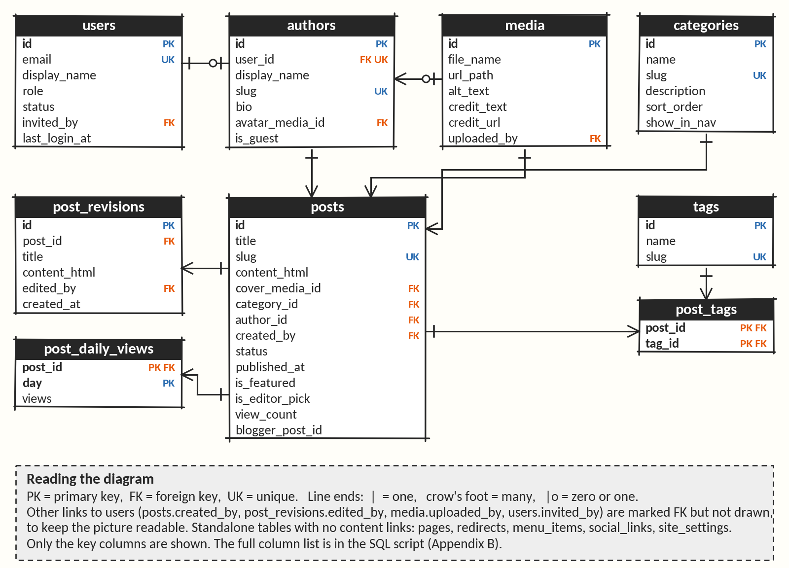

*Figure 2. ER diagram 1: people, content and media*

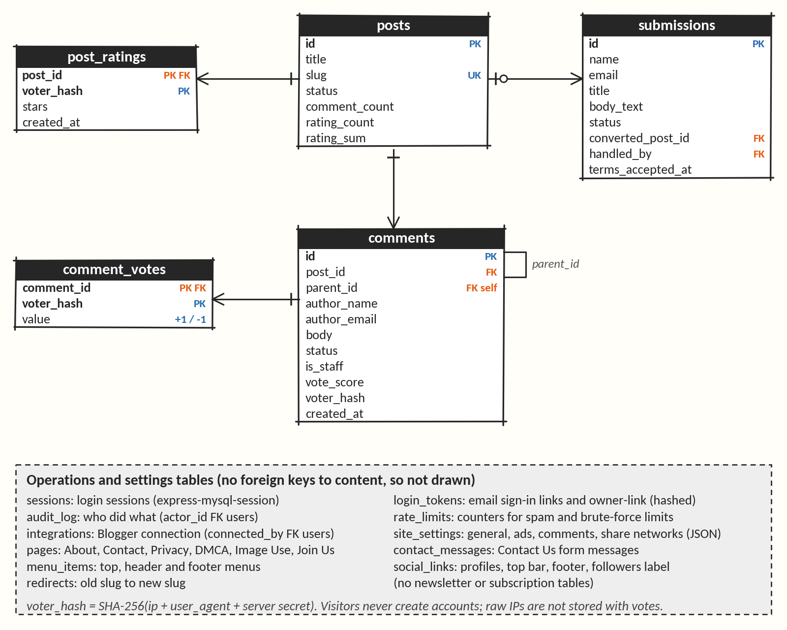

*Figure 3. ER diagram 2: reader interaction, plus the other tables*

### 4.3 Table catalog (24 tables)

| Table | Purpose and key points |
| --- | --- |
| users | The allowlist. email (unique), role (owner/editor), status (invited/active/disabled). |
| authors | Public bylines and author pages. Optional link to a user; `is_guest` for reader-submitted stories; `show_on_about` controls About Us visibility. |
| login_tokens | Hashed one-time tokens for email sign-in links and the owner command. |
| sessions | Login sessions (created by express-mysql-session). |
| media | Uploaded images: alt text, credit text and link, size, uploader. |
| categories, tags, post_tags | Taxonomy. One category per post, up to 5 tags. |
| posts | All posts. Status, schedule, SEO fields, flags (featured, editor pick, allow comments), Blogger sync fields and cached counters (views, comments, ratings). FULLTEXT index for search. |
| post_revisions | Saved versions of a post (last 50). |
| redirects | Old slug → new slug (301). |
| post_daily_views | Views per post per day (for Popular posts 7/30 days). |
| comments | Reader comments with replies (`parent_id`), status (pending/approved/spam/trashed), vote score, staff flag. |
| comment_votes | One up or down vote per visitor per comment. |
| post_ratings | One 1-5 star rating per visitor per post. |
| submissions | Stories sent through the Contact Us page; link to the draft created from it. |
| contact_messages | Messages from the Contact Us form. |
| pages | Static pages (About Us, Contact Us, Privacy, Image Use, DMCA, story terms, Join Us, Terms). |
| menu_items | Top, header and footer menus. |
| social_links | Social profiles, where each shows, and the follower label. |
| site_settings | JSON settings (4.5). |
| integrations | Blogger connection (encrypted refresh token). |
| audit_log | Who did what and when. |
| rate_limits | Counters for spam and brute-force limits. |

### 4.4 Rules

- All times are stored in UTC (`DATETIME`). Set the connection time zone to `+00:00` and convert for display.
- Emails are stored lowercase and trimmed; `normalizeEmail()` in `src/lib/email.js` does this everywhere. Slugs are checked in `src/lib/slug.js` against the reserved list and `pages.slug` (1.5). Posts and comments are soft-protected: drafts are soft-deleted (`deleted_at`); published posts are archived, never deleted.
- Counters on `posts` (`view_count`, `comment_count`, `rating_*`) are updated in the same transaction as the change. `scripts/recount.js` (nightly job) recalculates them from source rows to repair any drift.
- Visitors have no accounts. Votes, ratings and rate limits use `voter_hash = SHA-256(ip + user_agent + HASH_SECRET)`. Raw IPs are never stored with votes or ratings (only the audit log keeps an IP).
- Foreign keys: deleting a post removes its revisions, views, tags, comments, votes and ratings (CASCADE). Deleting a user keeps their content (SET NULL). An author with posts cannot be deleted (RESTRICT).
- Use `utf8mb4` everywhere so emoji and all languages work.

### 4.5 site_settings keys

| Key | Value (JSON) |
| --- | --- |
| general | siteName, tagline, contactEmail, submissionsEmail, businessName, address, timezone, footerBlurb. |
| editors_can_publish | { value: false } |
| blogger_auto_sync | { value: true } |
| comments | { moderation: all \| first_time \| none, maxDepth: 3, closeAfterDays: 0, blocklist: [] } |
| share_networks | Ordered list: facebook, x, pinterest, whatsapp, linkedin, reddit, telegram, email, copy. |
| ads | { provider, publisherId, slots: { home_feed, home_sidebar, post_after_p3, post_end, post_sidebar } } |

The complete `CREATE TABLE` script is in Appendix B and in `database/schema.sql`.

## 5. Roles, sign-in and access control

### 5.1 Permission matrix

| Action | Reader | Editor | Owner |
| --- | --- | --- | --- |
| Read, search, comment, rate, vote, share, submit a story, send a message | Yes | Yes | Yes |
| Sign in to /aadmin | No | Yes (invited) | Yes |
| Create posts, edit own drafts | No | Yes | Yes |
| Edit other people's posts | No | No | Yes |
| Submit a post for review | No | Yes | Yes |
| Publish or schedule | No | Only if setting is ON | Yes |
| Edit a published post | No | Only if setting is ON (own posts) | Yes |
| Approve or reject a post in review | No | No | Yes |
| Archive a post | No | No | Yes |
| Delete a draft | No | Own drafts | Any draft |
| Upload images, edit alt text | No | Yes | Yes |
| Delete images | No | No | Yes (if unused) |
| Team, Settings, Social and menus, Ads, Blogger, Static pages, Contact messages, Audit log | No | No | Yes |
| Retry Blogger sync | No | No | Yes |
| Moderate comments | No | Yes | Yes |
| Review reader story submissions | No | Yes | Yes |
| Edit own author profile | No | Yes | Yes (any author) |

### 5.2 Sign-in methods

| Method | How it works |
| --- | --- |
| A. Google | Button “Continue with Google”. After Google returns, the server requires `email_verified = true` and checks the allowlist (5.4). |
| B. Email link | User types their email. If it is on the allowlist, the server emails a one-time link valid for 15 minutes. The page always shows the same message so nobody can discover who is invited. |
| C. Owner command (backstop) | Tokens can only be created by running `npm run owner-link` on the server (hosting or SSH access needed). It prints a one-time URL for the owner. The web route `/auth/owner-link` only redeems a valid token (hashed, 10 minutes, single use, rate limited). Use it only if A and B are both unavailable. |

### 5.3 Sign-in flow

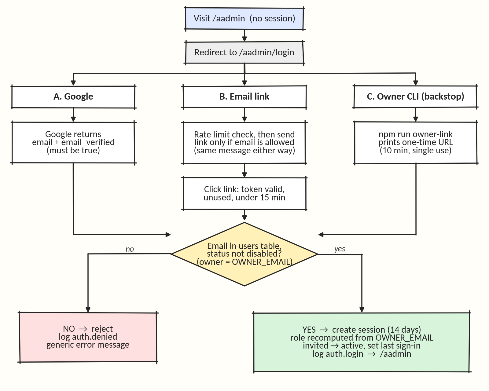

*Figure 4. Sign-in decision flow*

### 5.4 Rules (all mandatory)

1. Compare emails in lowercase after trimming spaces.
2. **The allowlist is the `users` table.** Inviting someone = the owner adds their email on the Team page. Nobody can sign in without a row whose status is not `disabled`.
3. **Owner = OWNER_EMAIL.** On every sign-in, if the email equals OWNER_EMAIL, create the row if missing, force role = owner and status = active. Any other user is an editor. The owner role can never be granted or removed in the UI.
4. On first successful sign-in, an invited user becomes active and `last_login_at` is stored.
5. Sessions are stored in MySQL (express-session + express-mysql-session). The cookie holds only a random session id: httpOnly, Secure, SameSite=Lax, 14-day maximum, with a visible Sign out button.
6. `requireRole()` re-reads the user row from the database on every request. Disabling an editor therefore takes effect immediately, even if their cookie is still valid.
7. Every `/aadmin` page, API route calls `requireRole('editor')` or `requireRole('owner')` itself. Middleware may redirect for convenience but is never the only check.
8. Email link: 32 random bytes, only the hash is stored, 15-minute expiry, single use, sent only to allowlisted emails. The response is identical for allowed and unknown emails.
9. Google sign-in uses OpenID Connect through `google-auth-library`: send `state` and `nonce`, verify the ID token, and require `email_verified = true` before the allowlist check.
10. Log every sign-in, denial and owner-link use in `audit_log`. Apply the rate limits in 10.1.

### 5.5 Recovery plan

| Situation | What to do |
| --- | --- |
| Google login is down or misconfigured | Use “Email me a sign-in link”. |
| Google and email are both down | Run `npm run owner-link` on the server and open the printed link. |
| You lost access to your Google account or email | Change OWNER_EMAIL in hosting settings, redeploy, then sign in with the email link at the new address. |
| An editor leaves or is compromised | Team page → Disable (instant). Remove later. |
| Protect the owner account | Turn on 2-Step Verification on the owner's Google account. |
| Google OAuth consent screen | Set it to Production. In Testing mode, tokens expire after 7 days and random lockouts follow. |

## 6. Public pages

Numbered circles on each wireframe match the numbered rows under it. Sketches show structure and behavior, not final colors or fonts.

### 6.0 Page map

| ID | Page | Route | Access |
| --- | --- | --- | --- |
| P1 | Home | `/` | Public |
| P2 | Post | `/{slug}` | Public (published only) |
| P3 | Category, tag, search | `/category/{slug}`, `/tag/{slug}`, `/search?q=` | Public |
| P4 | Static, 404, thank-you | `/privacy-policy`, `/image-use-policy`, `/terms`, `/story-terms`, 404, `/thank-you` | Public |
| P5 | Mobile behavior | same routes | Public |
| P6 | About Us, Contact Us (with story form) | `/about-us`, `/contact-us` | Public |
| P7 | Author, Join Us, DMCA | `/author/{slug}`, `/join-us`, `/dmca-removal` | Public |
| P8 | Saved stories, Surprise me | `/saved`, `/random` | Public, noindex |
| A1 | Sign in | `/aadmin/login` | Public, noindex |
| A2 | Dashboard | `/aadmin` | Editor, Owner |
| A3 | Post editor | `/aadmin/posts/new`, `/aadmin/posts/{id}` | Editor, Owner |
| A4 | Media | `/aadmin/media` | Editor, Owner |
| A5 | Team | `/aadmin/team` | Owner |
| A6 | Settings | `/aadmin/settings` | Owner |
| A7 | Audit log | `/aadmin/audit` | Owner |
| A8 | Static pages | `/aadmin/pages` | Owner |
| A9 | Inbox: Comments tab | `/aadmin/inbox?tab=comments` | Editor, Owner |
| A10 | Inbox: Stories, Messages tabs | `/aadmin/inbox?tab=stories` | Editor (stories), Owner (messages) |
| A11 | Social links and menus | `/aadmin/settings` (tab) | Owner |
| A12 | My profile | `/aadmin/profile` | Editor, Owner |

### 6.1 P1 Home  ( / )

**Purpose:** show the newest stories and send readers deeper into the site. **Access:** public. Rendered on the server, cached 60 seconds (3.3).

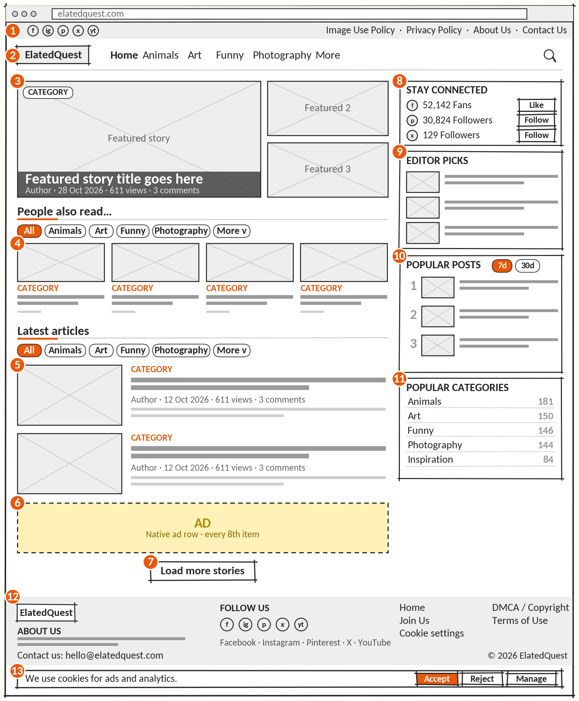

*Figure 5. P1 Home page (desktop)*

| # | Element | Behavior and rules |
| --- | --- | --- |
| 1 | Top bar | Left: social icons from `social_links` (those with “top bar” on). Right: the `top` menu (Image Use Policy, Privacy Policy, About Us, Contact Us). Icons without a URL are hidden. |
| 2 | Header | Logo to `/`, category navigation (`show_in_nav` categories, max 6 then “More”), and the search icon. Sticky on desktop. No extra call-to-action button. |
| 3 | Featured area | Show newest featured post (else newest published) and next featured/editor pick as equal lead cards in 2 columns. Each lead cover measures 324×163 px at a 1280 px viewport; scale proportionally below that width. Place title under cover, then author, date and a comment-count badge; show a 3-line excerpt. Show the third pick below as a compact 96×68 px thumbnail row. Do not add the deferred People also read heading or category tabs. |
| 4 | People also read… | Category tabs (All + top categories, “More” menu). Show 2 lead cards and 16 compact cards. The browser removes posts already in `localStorage.readPosts`; fill remaining slots with unread published posts, cycling the available pool only when fewer than 18 remain. Hide the section when no unread posts remain. New published posts take filler slots naturally. Tabs are real links to category pages (work without JavaScript). |
| 5 | Latest articles | Three-column cards across the 1068 px inner homepage width at 1280 px: each card 329×165 px image, 40 px column and row gaps. At 640–1023 px use two columns; below 640 px use one. Card order: image, 20 px bold title (2 lines max), category badge, author, date, comment-count badge, then 3-line excerpt. Category badge is a dark rounded label in the metadata line under the title. 10 posts per page. Do not show view counts on homepage cards. |
| 6 | Native ad row | Slot `home_feed`, after every 8th item, labelled “Advertisement”, space reserved (8.12). |
| 6a | Promoted content | Slot `home_sidebar` below Stay Connected, labelled “Advertisement”, 324×250 px reserved area below 1280 px and up to 403×250 px at wider desktop; omitted until configured (8.12). |
| 7 | Load more | Loads the next 10 rows via `/api/posts?page=2&category=…`. Also a normal link `?page=2` for crawlers and no-JS. |
| 8 | Stay connected | Social links with “stay connected” on: icon, `followers_label` (typed by the owner, e.g. “52,142 Fans”) and a Like or Follow link that opens the profile. At wide desktop, render configured profiles as three equal square tiles about 123×125 px. Hidden if none are set. |
| 9 | Editor picks | 3 newest posts with `is_editor_pick`; sidebar width 324 px at 1280 px viewport, with 96×68 px thumbnails and title to the right. |
| 10 | Popular posts | Top 5 by views over 7 days (`post_daily_views`); cached 1 hour. Render 96×68 px thumbnails and title to the right. The 7/30-day toggle remains deferred to M6. |
| 11 | Popular categories | Top 8 categories by published post count, with counts. |
| 12 | Footer | Logo, short About text and contact email, “Follow us” icons (`show_in_footer`), the `footer` menu (Home, Saved stories, Surprise me, Join Us, DMCA, Terms), Cookie settings link, copyright. |
| 13 | Consent banner | Slim bottom bar until the reader chooses. Ads and cookie-based analytics wait for consent where the law requires it (11.4). |

**Desktop reference geometry (updated 12 Nov 2026):** At a 1463 px viewport, use a centered homepage/header shell up to 1429 px wide with 48 px side padding (about 1333 px inner content). In the top grid, target an 870 px reading column, 60 px gap, and 403 px sidebar. The two People Also Read lead cards share the reading column equally with a 60 px gap and use 2:1 covers; compact rows use 120×85 px thumbnails. At widths from 1024 px through 1279 px, retain the existing 324 px sidebar and 48 px gap so lead cards remain usable. Keep the existing stacked mobile/tablet layout below 1024 px. Social cards may use the larger square-tile treatment when configured; do not invent profiles or follower counts. Promoted content remains consent-gated and appears only when configured.

**Empty state:** no posts yet → “No stories yet.” **SEO:** title = site name + tagline; canonical `/`; `?page=N` has a self canonical.

### 6.2 P2 Post page  ( /{slug} )

**Purpose:** reading plus interaction. **Access:** public, only status = published and `published_at` ≤ now. The first figure shows the reading area, the second the interaction area below it.

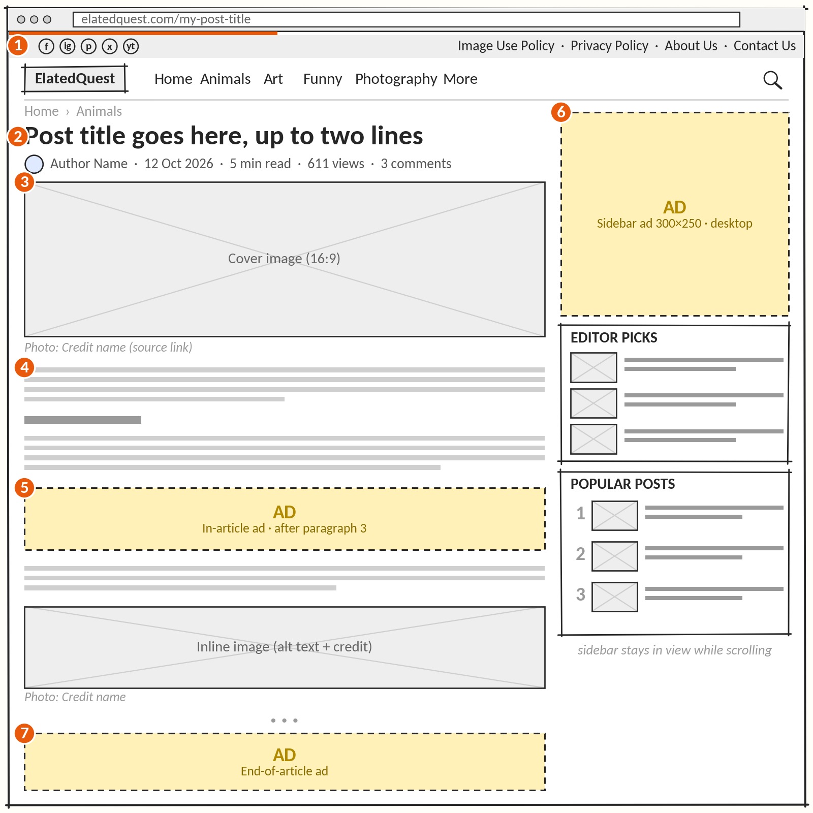

*Figure 6. P2 Post page, part 1: reading area*

| # | Element | Behavior and rules |
| --- | --- | --- |
| 1 | Progress bar + header | 3 px bar at the very top fills as the reader scrolls the article. Top bar and header as on Home. |
| 2 | Title and meta | Breadcrumb Home › Category. One `h1`. Meta: author (links to `/author/{slug}`), date, reading time, **view count**, **comment count** (links to `#comments`). |
| 3 | Cover + credit | 16:9, width/height set, alt text, loaded first. The media credit text/link shows under it. |
| 4 | Article body | Sanitized HTML, column max 680 px, 18 px text. Inline images show alt text and credit. |
| 5 | In-article ad | Slot `post_after_p3`, after paragraph 3, only if the article has at least 6 paragraphs. |
| 6 | Sidebar (≥ 1024 px) | Sticky: `post_sidebar` ad, Editor picks, Popular posts. Not shown on mobile. |
| 7 | End-of-article ad | Slot `post_end`. |

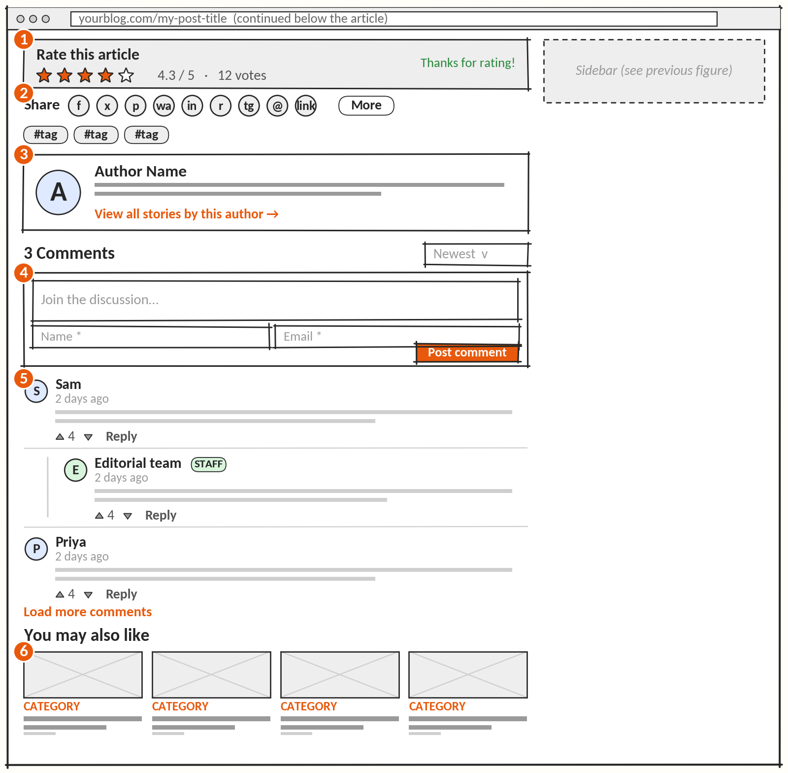

*Figure 7. P2 Post page, part 2: interaction area*

| # | Element | Behavior and rules |
| --- | --- | --- |
| 1 | Rating | 5 stars, one vote per visitor (changeable). Shows average and number of votes (8.7). |
| 2 | Share + tags | Share buttons from `share_networks` + “More” (native share on phones) and a Save button (8.17). Tag chips link to `/tag/{slug}` (8.8). |
| 3 | Author box | Avatar, name, short bio, “View all stories by this author” → `/author/{slug}`. |
| 4 | Comment form | Name, email (never shown), text, Post comment. No website field. Honeypot and time trap hidden inside (8.6). |
| 5 | Comment list | Count, sort (Newest, Oldest, Most voted), replies up to 3 levels, up/down votes, STAFF badge, initials avatar. 10 per load + “Load more comments”. |
| 6 | You may also like | 4 related posts (8.5). |

- **On load:** one `POST /api/posts/:id/view` per session per post, then add the id to `localStorage.readPosts` (newest first, keep 200).
- **Structured data:** JSON-LD `Article` and `BreadcrumbList`. Do **not** add rating markup (self-reviews are not eligible).
- **Not found:** unknown slug → check `redirects` (301), else 404. Archived posts return 404. Max 3 ads on desktop, 2 on mobile.

### 6.3 P3 Category, tag and search

**Routes:** `/category/{slug}`, `/tag/{slug}`, `/search?q=`. **Access:** public.

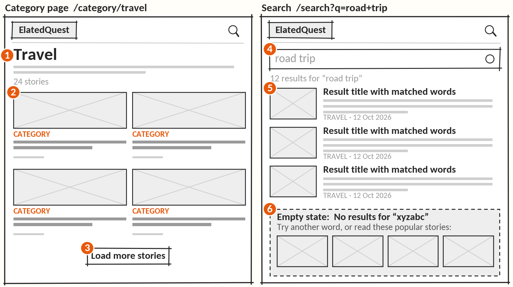

*Figure 8. P3 Category page (left) and search page (right)*

| # | Element | Behavior and rules |
| --- | --- | --- |
| 1 | Archive heading | Category or tag name as `h1`, description, post count. Uses the same card grid and ad rules as the home page. |
| 2 | Archive grid | 12 posts per page, newest first. |
| 3 | Load more / pagination | Same pattern as home (button plus real `?page=N` links). |
| 4 | Search box | GET form to `/search?q=`. Autofocus. Minimum 2 characters. Search pages are `noindex`. |
| 5 | Search results | 20 per page. Each row: thumbnail, title, snippet with matched words highlighted, category, date. Ranked by relevance then recency (8.14). |
| 6 | Empty state | “No results for …”, a hint to try another word, plus 4 popular posts and the category list. |

- Category pages are indexable with a self canonical. Tag pages are indexable only when the tag has 3 or more posts; otherwise `noindex`.
- No ads on search results.

### 6.4 P4 Static, 404 and thank-you pages

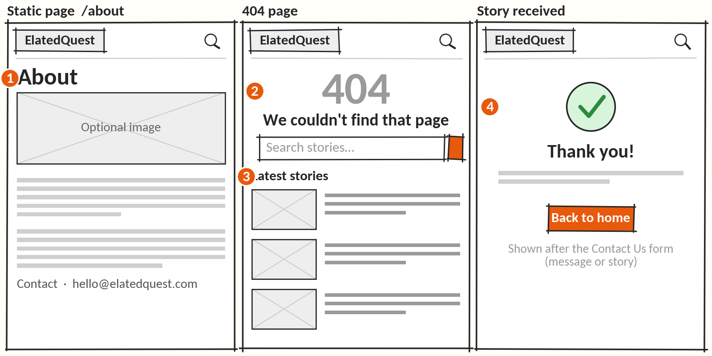

*Figure 9. P4 Static page, 404 page and “story received” page*

| # | Element | Behavior and rules |
| --- | --- | --- |
| 1 | Static page | Privacy Policy, Image Use Policy, Terms and similar pages: title + sanitized HTML from `pages`, edited by the owner (A8). |
| 2 | 404 message | Friendly message with HTTP 404, `noindex`. |
| 3 | 404 helpers | Search box and the 6 newest posts. |
| 4 | Thank-you page | Shown after the Contact Us form (`/thank-you?type=story\|message`): “We received your message.”, button back to home. |

### 6.5 P5 Mobile behavior

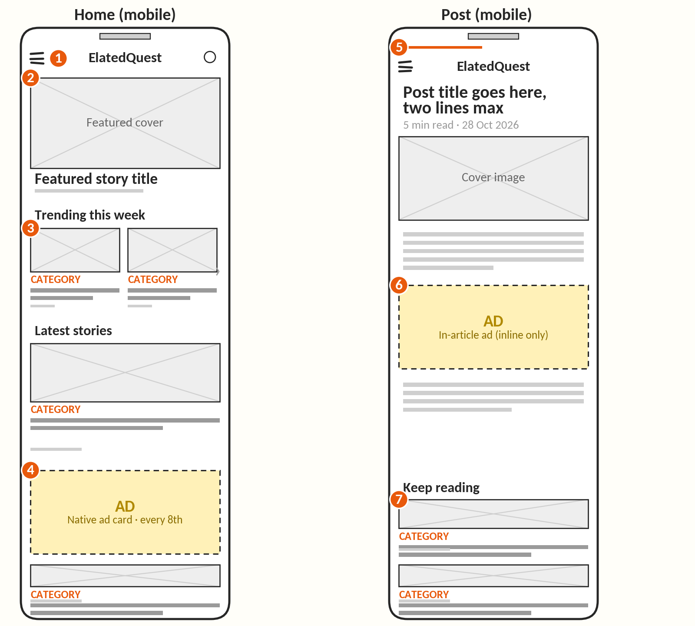

*Figure 10. P5 Mobile home (left) and mobile post (right)*

| # | Element | Behavior and rules |
| --- | --- | --- |
| 1 | Menu | Hamburger opens a drawer with categories and search. |
| 2 | Featured card | Full-width cover, title below. |
| 3 | Popular scroller | Horizontal, scroll-snap row instead of a sidebar list. |
| 4 | Native ad card | Same rule as desktop: every 8th card, labelled, reserved height. |
| 5 | Progress bar | Same bar at the top of the post. |
| 6 | In-article ad | Inline only (300×250 or responsive). Never sticky, anchored to the screen edge or full-screen. |
| 7 | Related posts | Stacked single column. |

- Tap targets at least 44 px. Body text at least 17 px. No horizontal scrolling on any page.
- No sidebar on mobile. Total ads on a mobile post page: at most 2.

### 6.6 P6 About Us and Contact Us (messages and stories)

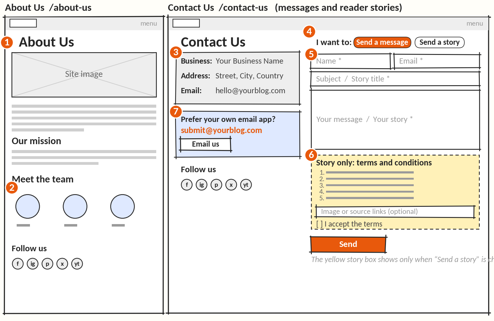

*Figure 11. P6 About Us (left) and Contact Us with message and story form (right)*

| # | Element | Behavior and rules |
| --- | --- | --- |
| 1 | About Us text | `/about-us`. Story, mission, image. The owner edits it in A8. |
| 2 | Meet the team | Authors with `show_on_about` on (avatar, name, link to their author page), plus “Follow us” icons. |
| 3 | Business details | `/contact-us`. Business name, address and email come from `site_settings.general`. |
| 4 | Type switch | “I want to: Send a message / Send a story”. Two radio options; `?type=story` in the address pre-selects the story option. Works without JavaScript (the story box is simply always visible). |
| 5 | Form fields | Name, email, subject (or story title), message (or story text). One form posts to `POST /contact-us` with a `type` field (8.10). |
| 6 | Story extras | Shown only for “Send a story”: terms and conditions (text from the `story-terms` page, starter text in `seed.sql`), optional image or source links, and the “I accept the terms” box, which is required. Story text: 100 to 20,000 characters (8.9). |
| 7 | Email option | Shows the address and an “Email us” button (`mailto:`) for people who prefer their own email app. |

### 6.7 P7 Author page, Join Us, DMCA

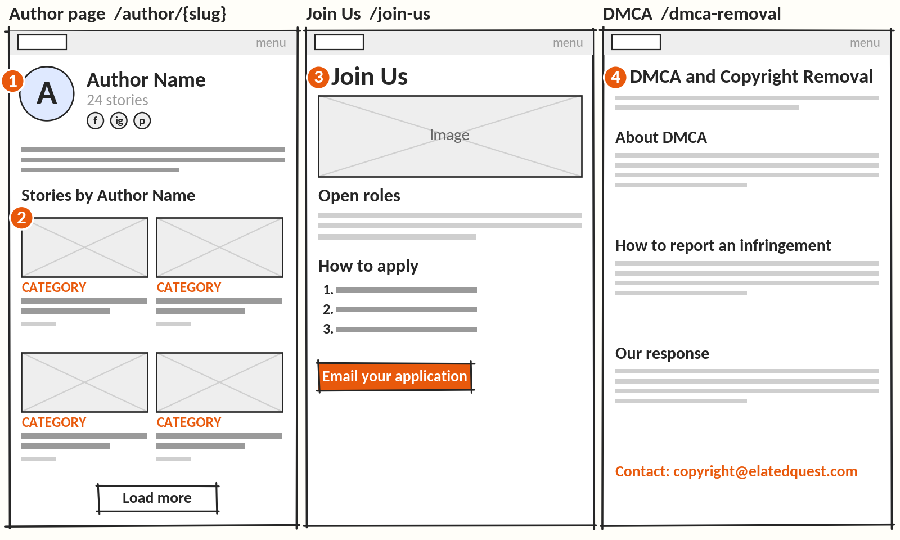

*Figure 12. P7 Author page (left), Join Us (middle), DMCA page (right)*

| # | Element | Behavior and rules |
| --- | --- | --- |
| 1 | Author header | `/author/{slug}`: avatar, name, story count, bio, optional social links. |
| 2 | Author's stories | Grid of that author's published posts, 12 per page + Load more. Indexable. |
| 3 | Join Us | `/join-us` (optional): open roles, how to apply by email. Text from `pages`. |
| 4 | DMCA page | `/dmca-removal`: how to report infringement, what the notice must contain, how you respond, contact email. Image Use Policy and Privacy Policy use the same simple text layout. |

### 6.8 Global elements

- **Top bar, header, footer, menus and social links** are shared partials fed by `menu_items` and `social_links` (8.11).
- **Consent banner** and “Cookie settings” link: remember the choice 6 months in a first-party cookie.
- **Skip-to-content link** and visible keyboard focus everywhere.
- **Fonts:** system font stack or one self-hosted variable font with `font-display: swap`.
- No subscription forms and no separate “Submit story” button anywhere: stories are sent from the Contact Us page.

### 6.9 P8 Saved stories and Surprise me

`/saved` lists the stories a reader saved on this device (8.17). `/random` redirects to a random published story. Both are `noindex`. No wireframe is needed.

## 7. Admin pages  ( /aadmin )

> **Important:** Every admin page and every action behind it re-checks the user's role on the server (5.4 rule 7). Hiding a button is only a convenience, never protection. Admin pages are `noindex`, `no-store` and never load ads or ad scripts.

### 7.1 A1 Sign in  ( /aadmin/login )

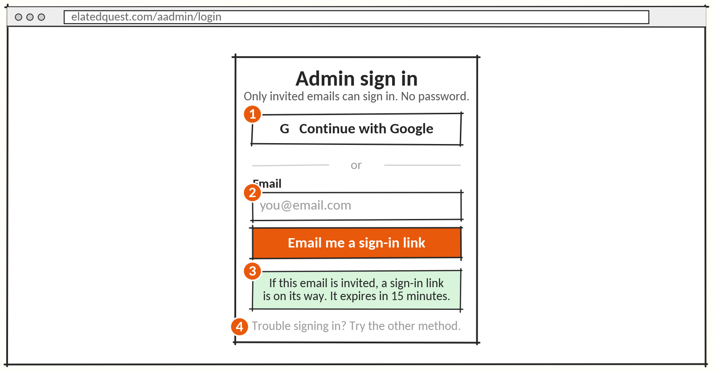

*Figure 13. A1 Sign-in page*

| # | Element | Behavior and rules |
| --- | --- | --- |
| 1 | Google button | Starts the Google sign-in. Disabled for 3 seconds after a click to prevent double submits. |
| 2 | Email field and link button | Sends a one-time link if the email is allowed. Button is disabled for 30 seconds after use. |
| 3 | Message area | Always shows the same text after a request: “If this email is invited, a sign-in link is on its way. It expires in 15 minutes.” Errors from Google show: “Sign-in failed, or this account isn't invited.” Never say which. |
| 4 | Help text | “Trouble signing in? Try the other method.” No other links. |

- If the visitor already has a valid session, redirect to `/aadmin`.
- No registration, no password field, no “forgot password”.

### 7.2 A2 Dashboard  ( /aadmin )

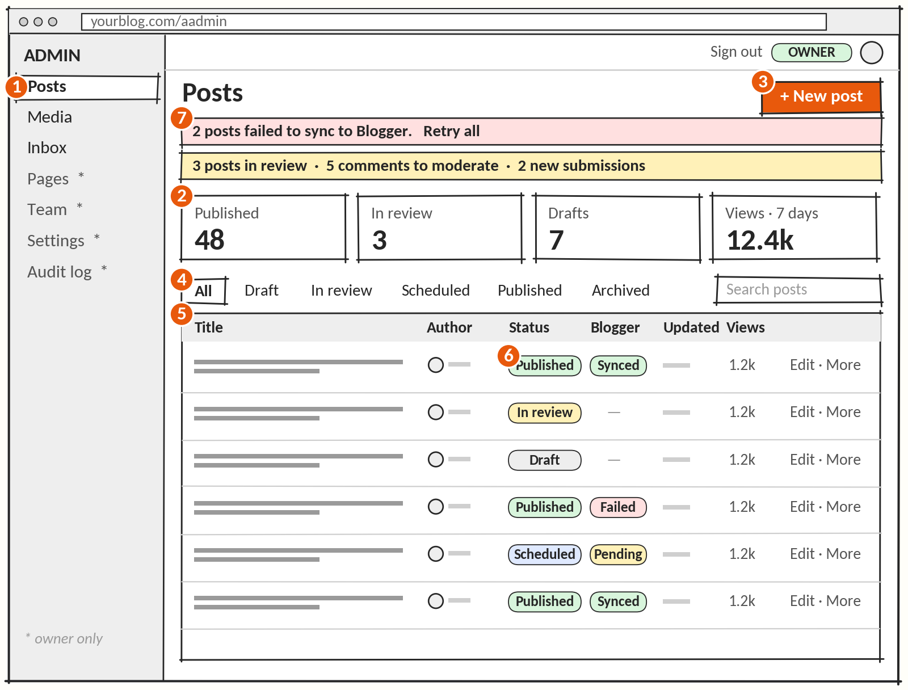

*Figure 14. A2 Dashboard*

| # | Element | Behavior and rules |
| --- | --- | --- |
| 1 | Sidebar | Posts, Media and Inbox (Comments and Stories tabs) for everyone. Pages, Team, Settings, Audit log and Inbox → Messages are owner only: hidden for editors and also blocked on the server. |
| 2 | Stat cards | Published, In review, Drafts, Views in the last 7 days. Editors see counts for their own posts only. |
| 3 | New post | Creates an empty draft and opens the editor. |
| 4 | Tabs and search | Filter by status; search by title. After 2 typed characters, show up to 8 permitted post suggestions after a 250 ms debounce. Keyboard arrows move through suggestions, Enter chooses, and Esc closes them. Choosing one filters the table to that post. Plain form submission works without JavaScript. 20 rows per page, newest updated first. |
| 5 | Posts table | Title, author, status badge, Blogger badge, last updated, views (7 days), actions: Edit, Preview, Archive (owner), Delete (drafts). |
| 6 | Badges | Status: Draft, In review, Scheduled, Published, Archived. Blogger: Synced, Pending, Failed, or a dash when not applicable. |
| 7 | Alert banners | Owner only. Red: “n posts failed to sync to Blogger. Retry all” (also shown if the Blogger connection needs reconnecting). Yellow: counts of posts in review, comments to moderate and new submissions, each linking to its page. |

### 7.3 A3 Post editor  ( /aadmin/posts/new, /aadmin/posts/{id} )

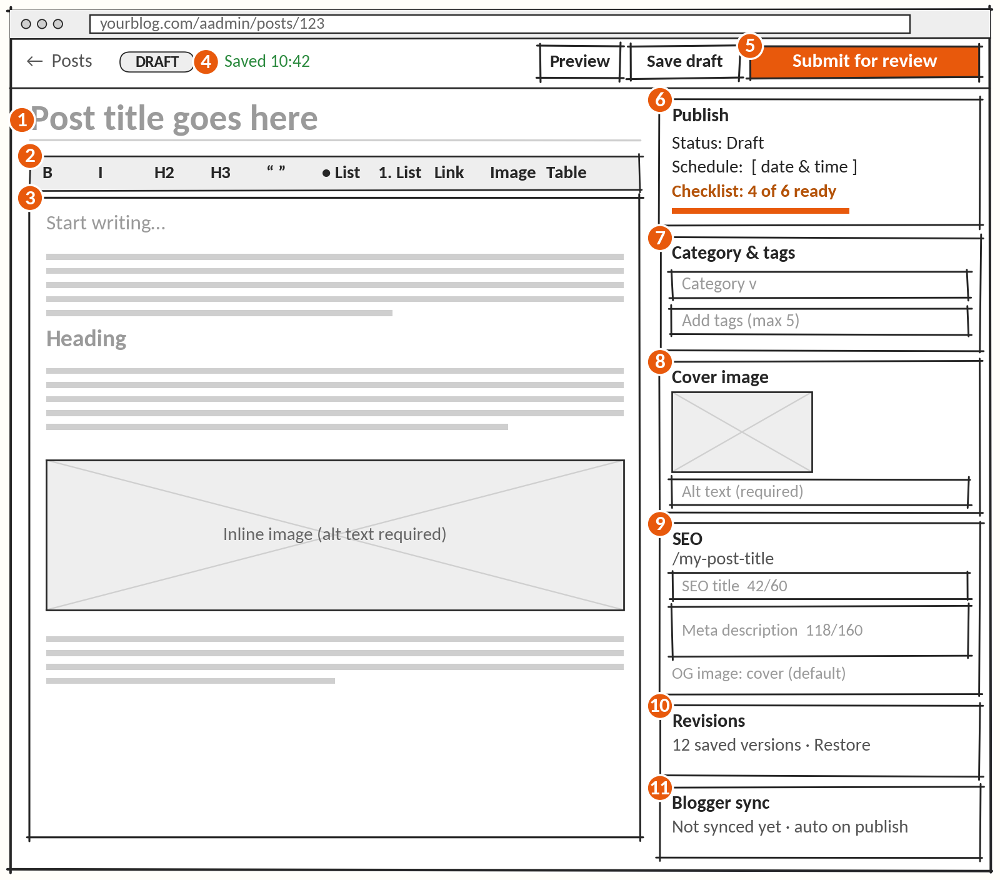

*Figure 15. A3 Post editor*

| # | Element | Behavior and rules |
| --- | --- | --- |
| 1 | Title | Large input. Required. Max 120 characters. The slug is generated from it. |
| 2 | Toolbar | Bold, italic, H2, H3, quote, bullet and numbered lists, link, image (from the media library). No H1. |
| 3 | Body | Quill editor (self-hosted, vanilla JavaScript). Content is sanitized again on the server on every save (8.3). Body images are centered, fit the column, and have Small / Medium / Full width presets; height stays proportional. Preview shows each image's media credit as a caption. |
| 4 | Status and autosave | Status pill plus “Saved 10:42”. Autosaves 10 seconds after the last change. Warns before leaving with unsaved changes. |
| 5 | Action buttons | Preview, Save draft, and one primary button: “Submit for review” (editor), or “Publish” / “Schedule” (owner, or editor when allowed). |
| 6 | Publish panel | Status, schedule date and time (shown in the owner's time zone, stored in UTC), and the publish checklist: title, slug, cover + alt text, category, body, meta description ≤ 160. Publish stays disabled until all are ready. |
| 7 | Category and tags | Choose one category and up to 5 tags. Choose the author byline (default: you; the owner can pick any author). Owner only: “Featured” and “Editor pick” switches. “Allow comments” switch. |
| 8 | Cover image | Pick from the library or upload. Alt text is required. |
| 9 | SEO | Slug (editable until first publish), SEO title (≤ 60, default = title), meta description (≤ 160, default = excerpt), social image (default = cover), advanced canonical URL. Show live character counters. |
| 10 | Revisions | Collapsible panel, closed by default. Lists saved versions with time and author. “Restore” creates a new revision; nothing is ever overwritten. |
| 11 | Blogger sync | Shows none / pending / synced / failed, the last error, and a Retry button for the owner. |

The editor has a wide main column and a sticky sidebar with its own scroll area. The sidebar must independently scroll to its final panel at any viewport height. Publish and Category and tags are expanded by default; Cover, SEO, Revisions, and Blogger are collapsed. Blogger shows the persisted connection and post sync status, with a retry action for the owner when a sync failed.

#### Field rules

  The toolbar has no table button because the Quill core build does not provide one.

| Field | Limit | Rule |
| --- | --- | --- |
| Title | 1–120 | Required. |
| Slug | ≤ 80 | a–z, 0–9, hyphen. Unique across posts and static pages. Not in the reserved list (Appendix A). Locked after first publish; to change it the owner confirms, and a 301 redirect is saved. |
| Excerpt | ≤ 200 | Auto-filled from the first paragraph if empty. |
| Category | 1 | Required to publish. |
| Tags | 0–5 | Lowercase slugs. |
| Cover + alt | — | Both required to publish. |
| Meta description | ≤ 160 | Required to publish. |

### 7.4 A4 Media library  ( /aadmin/media )

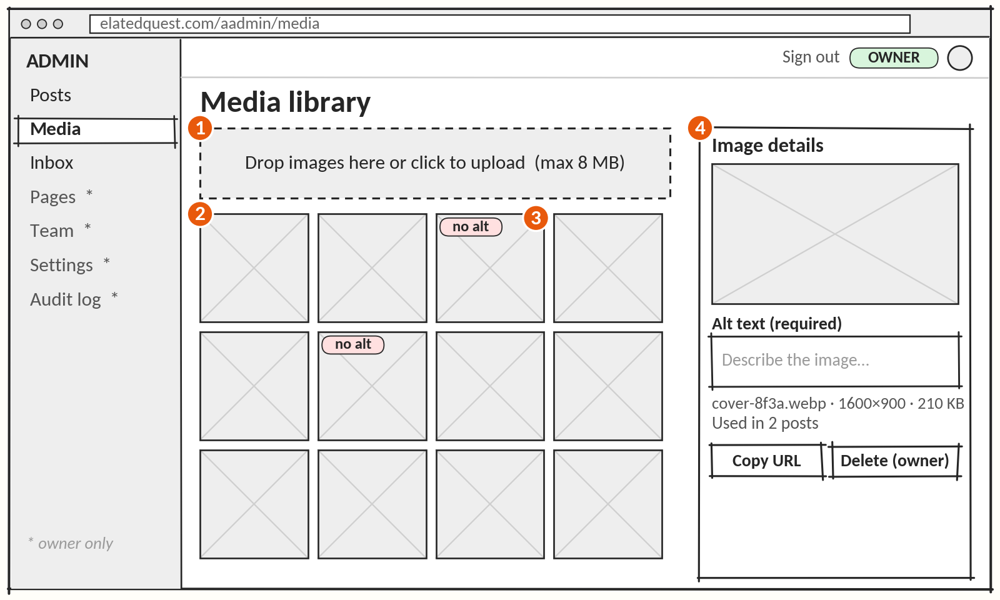

*Figure 16. A4 Media library*

| # | Element | Behavior and rules |
| --- | --- | --- |
| 1 | Upload area | Drag and drop or click. JPG, PNG, WebP, GIF. Maximum 8 MB. SVG is not allowed. |
| 2 | Image grid | Newest first. Click to select. |
| 3 | “no alt” badge | Images without alt text are flagged and cannot be inserted into a post until alt text is added. |
| 4 | Details panel | Preview, alt text, credit text and link (shown under the image), file name, size, “used in n posts”, Copy URL, Delete (owner only, and only if unused). |

- On upload: verify the real file type from its first bytes, reject mismatches, resize to a maximum of 2000 px wide, convert to WebP, create 400, 800 and 1200 px versions, and store under a random file name.
- Serve images with long cache headers and `srcset`.
- After upload, clear the file input and preview, add the uploaded image at the top of the grid, and select it. Grid thumbnails use the 400 px variant with square dimensions, `object-fit: cover`, and lazy loading. The details preview uses `object-fit: contain` and is at most 240 px tall. Show clear errors for unsupported types, files over 8 MB, and upload limits.

### 7.5 A5 Team  ( /aadmin/team, owner only )

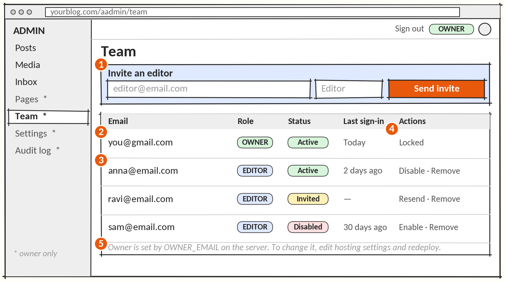

*Figure 17. A5 Team page*

| # | Element | Behavior and rules |
| --- | --- | --- |
| 1 | Invite form | Email + role (Editor) + “Send invite”. Creates a `users` row with status = invited and emails a short notice with the sign-in address. No token is needed because the allowlist is the invite. |
| 2 | Owner row | Shown first, locked: cannot be disabled, edited or removed. Its email comes from OWNER_EMAIL. |
| 3 | Editor rows | Email, role, status (Invited, Active, Disabled), last sign-in. |
| 4 | Actions | Disable / Enable (instant effect), Resend invite, Remove. Removing reassigns that person's posts to the owner. |
| 5 | Server note | Reminder that the owner email is a server setting. |

### 7.6 A6 Settings  ( /aadmin/settings, owner only )

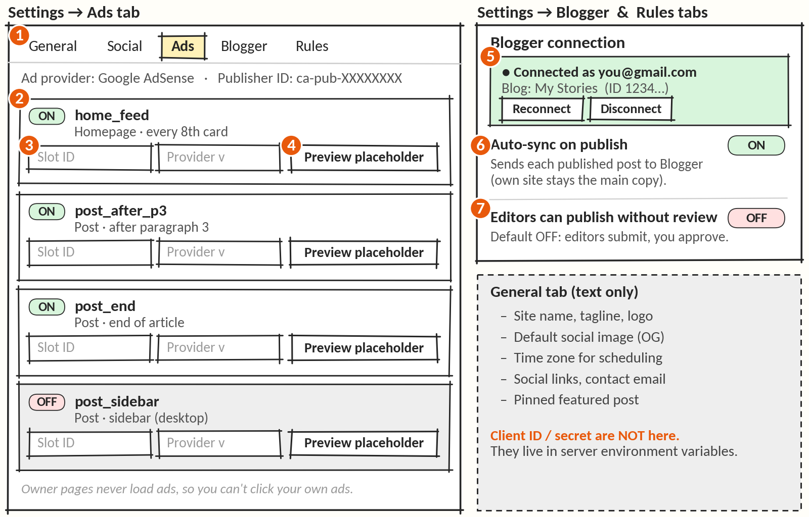

*Figure 18. A6 Settings: Ads tab (left), Blogger and Permissions tabs (right)*

| # | Element | Behavior and rules |
| --- | --- | --- |
| 1 | Tabs | General, Social and menus (A11), Ads, Blogger, Rules. |
| 2 | Ad slot row | Each slot (`home_feed`, `home_sidebar`, `post_after_p3`, `post_end`, `post_sidebar`) has an ON/OFF switch, a name and a description. |
| 3 | Provider and IDs | Provider (AdSense or Custom), publisher ID (once, for all slots) and slot ID. “Custom” allows pasting an ad snippet; only the owner can edit it. |
| 4 | Preview placeholder | Shows a grey placeholder in the slot on the public site for the owner only, so layout can be checked without loading real ads. |
| 5 | Blogger connection | Connect, reconnect, disconnect. Shows the connected Google account and the chosen blog. Details in 8.4. |
| 6 | Auto-sync | When ON, every published post is sent to Blogger automatically. |
| 7 | Editors can publish | Default OFF. When ON, editors can publish and edit their own published posts without review. |

- **Rules tab:** editors-can-publish switch, comment moderation mode, blocklist words, auto-close days. **General tab:** site name, tagline, logo, default social image, time zone for scheduling, social links, contact email, pinned featured post.
- **Not here:** Google client ID and secret. They are environment variables (3.8).

### 7.7 A7 Audit log  ( /aadmin/audit, owner only )

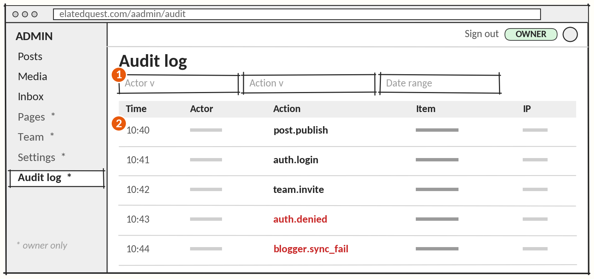

*Figure 19. A7 Audit log*

| # | Element | Behavior and rules |
| --- | --- | --- |
| 1 | Filters | By actor, action and date range. |
| 2 | Log table | Time, actor, action, item, IP. Read only. Denied and failed events are shown in red. Entries older than 12 months are deleted by the cleanup job. |

### 7.8 A8 Static pages manager  ( /aadmin/pages, owner only )

A simple list of the seeded pages (About Us, Contact Us, story terms, Privacy Policy, Image Use Policy, DMCA, Join Us, Terms) with an Edit button. Editing opens the same editor as A3 without category, tags, cover image or review workflow; saving publishes immediately. The editor sanitizes content exactly like posts. No new wireframe is needed.

### 7.9 A9 Inbox: Comments tab  ( /aadmin/inbox )

**Access:** Editor, Owner.

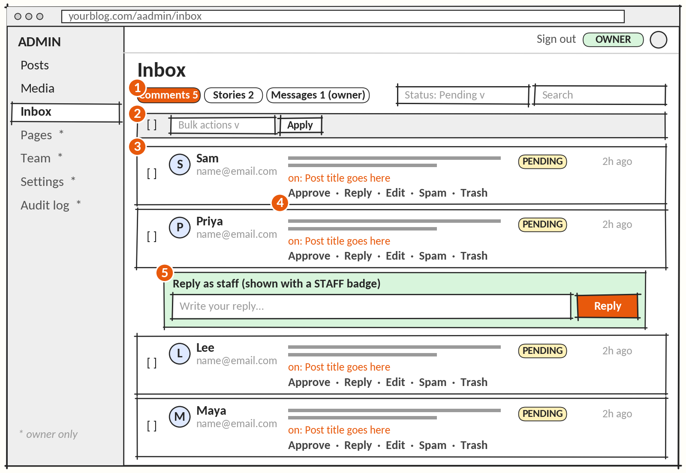

*Figure 20. A9 Inbox, Comments tab*

| # | Element | Behavior and rules |
| --- | --- | --- |
| 1 | Top tabs and filter | Top tabs: Comments (count), Stories, Messages (owner only). Filter list: Pending, Approved, Spam, Trash. |
| 2 | Bulk actions | Select rows, then Approve, Spam, Trash or Delete permanently. |
| 3 | Comment row | Name, email, text, post title (links to the post), status, time. |
| 4 | Row actions | Approve, Reply, Edit (typos or removing a link), Spam, Trash. Approving updates `posts.comment_count` in the same transaction. |
| 5 | Staff reply | Reply inline. It is published at once with the STAFF badge, under the original comment. |

### 7.10 A10 Inbox: Stories and Messages tabs  ( same page )

**Access:** Submissions tab for Editor and Owner; Messages tab for the Owner only.

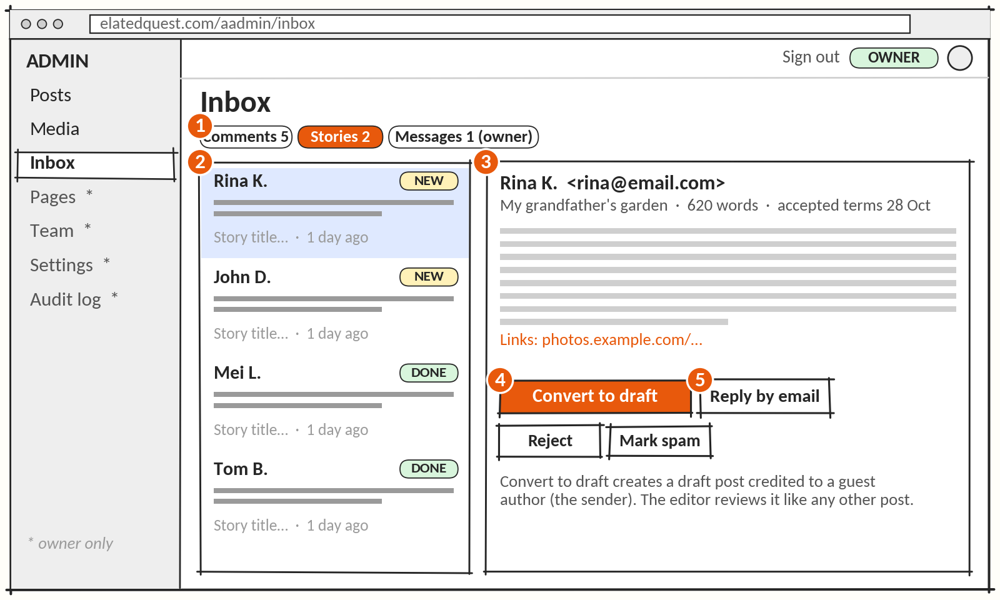

*Figure 21. A10 Inbox, Stories tab*

| # | Element | Behavior and rules |
| --- | --- | --- |
| 1 | Top tabs | Same tabs as A9. This view is the Stories tab; Messages is owner only. |
| 2 | List | Sender, status (New, Done), story title, age. |
| 3 | Detail | Sender name and email, title, full text, links, time terms were accepted. |
| 4 | Convert to draft | Creates a draft post with the cleaned text (blank lines become paragraphs), a **guest author** for the sender, and a review note with the sender's email; marks the submission accepted. The editor then edits and publishes it like any post. |
| 5 | Reply by email | Opens the editor's email app with the sender's address (`mailto:`). Also: Reject, Mark spam. |

### 7.11 A11 Settings: Social and menus

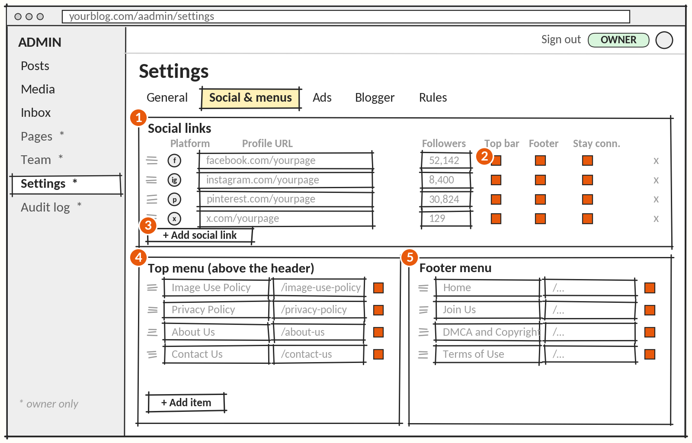

*Figure 22. A11 Social links and menus*

| # | Element | Behavior and rules |
| --- | --- | --- |
| 1 | Social links | One row per profile: platform (Facebook, Instagram, Pinterest, X, YouTube, TikTok, LinkedIn, Telegram, WhatsApp, Threads, Reddit), URL, follower label. |
| 2 | Where it shows | Switches: Top bar, Footer, Stay connected. A row with an empty URL or inactive is never shown. |
| 3 | Add link | Adds a row. Delete with the × button. Drag the handle to reorder. |
| 4 | Top menu | Links above the header. Each: label, URL, active switch, new-tab option. |
| 5 | Footer menu | Same editor for the footer links. |

Saving clears the cached header and footer. Changes are written to the audit log (`social.update`, `menu.update`).

### 7.12 A12 My profile  ( /aadmin/profile )

Every signed-in user edits their own author profile: display name, short bio, avatar (from the media library) and `show_on_about`. No wireframe: it is a plain form like the editor sidebar. The owner can edit any author in Team → Authors and create guest authors. The checkbox stores to `authors.show_on_about` (default 0); the About page reads this column (6.6).

### 7.13 A13 Categories  ( /aadmin/categories, owner only )

The Categories page lists categories and lets the owner add or rename a category, change its unique slug, sort order, and “show in navigation” setting. Deletion is allowed only when no post uses the category; otherwise show a clear message. Record `category.create`, `category.update`, and `category.delete` in `audit_log`. The owner-only link appears in the admin sidebar.

## 8. Feature specifications

### 8.1 Post lifecycle

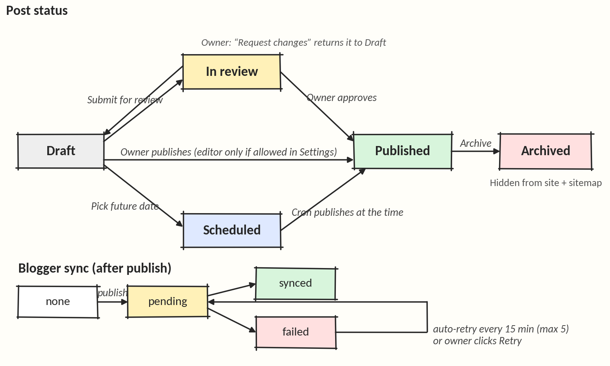

*Figure 23. Post status transitions and Blogger sync states*

| Transition | Who | Effect |
| --- | --- | --- |
| Draft → In review | Editor, Owner | Locks editing for the editor; emails the owner a short notice. |
| In review → Published | Owner | Sets `published_at`, clears the page cache, queues Blogger sync. |
| In review → Draft | Owner | “Request changes” with an optional note shown to the editor. |
| Draft → Published | Owner (editor only if allowed) | Same as above. |
| Published → Published | Owner | Republishes the saved edits, keeps the original `published_at`, records a revision, and clears the page cache. |
| Draft → Scheduled | Same as publish | Needs a future `scheduled_at`. The worker job runs every 5 minutes and publishes due posts. |
| Published → Archived | Owner | Returns 404 on the site, leaves the sitemap, keeps the data. Blogger copy is reverted to draft (best effort). |
| Delete | Editor (own), Owner | Drafts only, soft delete kept for 30 days. Published posts are archived, never deleted. |

Editors can edit only their own posts that are in Draft status. A published post can be edited by the owner (and by editors when the setting is ON). In user-facing role labels, show Owner as “Admin” and Editor as “Content Moderator”; do not rename stored role identifiers.

- **Action names and permissions (1.5):** `submit` = editor or owner, own draft → in_review. `publish` = owner (editor only if `editors_can_publish` is on), from draft or in_review; the owner may also republish an already published post after saving edits, keeping its original `published_at`; “approve” is publish on an in_review post. `reject` (“Request changes”) = owner only, in_review → draft, optional note up to 500 characters in `review_note`. `archive` = owner only.

### 8.2 Editor behavior

- **Autosave:** 10 seconds after the last change, saved to the draft fields only. It never changes what is public.
- **Revisions:** a snapshot is stored on manual save, submit, publish, and at most every 5 minutes during autosave. Keep the last 50 per post.
- **Overwrite protection:** every save sends the `updated_at` the editor loaded. If the database has a newer value, refuse and show “This post was changed by {name} at {time}. Reload to see their changes.”
- **Preview:** `/aadmin/preview/{id}` renders the real public template with a “Preview” banner and grey ad placeholders. It is visible only to signed-in users who may edit that post.
- **Images in the body** come only from the media library (so alt text and sizes are guaranteed).
- **Slug check:** creating or renaming a post rejects a reserved slug or any `pages.slug` (`src/lib/slug.js`). The public lookup order for `/{slug}` is: fixed routes and reserved slugs, posts, pages, redirects, 404.

### 8.3 Sanitization (mandatory)

Run on the server on every save, including autosave, before `content_html` is stored. Never trust the editor's output. A single malicious script in one post would run in every reader's browser.

| Item | Allowlist |
| --- | --- |
| Tags | p, br, h2, h3, h4, strong, em, u, s, blockquote, ul, ol, li, a, img, figure, figcaption, pre, code, hr, table, thead, tbody, tr, th, td |
| Attributes | a: href, title, target, rel. img: src, alt, width, height, loading. th/td: colspan, rowspan. |
| Links | Only http, https, mailto. External links get `rel="noopener noreferrer"`. |
| Images | `src` must point to the media domain (UPLOADS_PUBLIC_URL). `alt` is required. |
| Always removed | script, style, iframe, object, embed, form, input, h1, every `on*` attribute, inline `style`, `javascript:` and `data:` URLs. |

**Tests required:** payloads such as `<script>alert(1)</script>`, ``, `<a href="javascript:alert(1)">` and `<iframe src=...>` must come out clean. Also send a strict Content-Security-Policy as a second layer (10.2).

### 8.4 Blogger publishing

Blogger is a mirror. The site's own database is the main copy, so writing is never lost if Google is slow or down.

1. **Connect once (owner):** Settings → Blogger → Connect. Run a separate Google OAuth request for the Blogger scope with offline access. The redirect URI is `${SITE_URL}/api/admin/blogger/callback` and must be registered exactly in the OAuth web client’s Authorized redirect URIs in Google Cloud. Encrypt the refresh token with AES-256-GCM using ENCRYPTION_KEY and store it in `integrations`. Let the owner pick the blog and store `blog_id`. Enable the Blogger API in the same Google Cloud project and add the scope to the consent screen. An “unverified app” warning for the owner is expected.
2. **On publish:** first publish on the own site (this always succeeds). Then, if auto-sync is ON and Blogger is connected, set `blogger_sync_status = pending` and run the sync. The sync creates a Blogger post or updates the associated Blogger post; a stable ElatedQuest marker recovers an association after an interrupted request and prevents duplicate inserts. Posts already published before Blogger was connected are not backfilled automatically; the owner can select “Sync now” for an individual published post from the dashboard or post editor.
3. **Sync action:** if `blogger_post_id` is empty, create the post (public, not draft); otherwise update it. Send title, sanitized HTML with a closing line “Originally published at {own URL}”, and labels (category and tags). On success store `blogger_post_id`, `blogger_url`, `synced`, `blogger_synced_at`.
4. **On failure:** store `failed`, increase `blogger_attempts`, save a short error. The worker job every 15 minutes retries failed and pending posts, up to 5 attempts. The owner can click Retry at any time.
5. **No duplicates:** always check `blogger_post_id` before creating and acquire a per-post MySQL advisory lock so a double click or overlapping worker run cannot create two posts. If a process exits unexpectedly, MySQL releases its lock; a retry searches the stable ElatedQuest marker before inserting, recovering a post created before an interrupted response.
6. **Token problems:** if Google answers `invalid_grant`, set `needs_reconnect = true`, stop retrying and show the red banner to the owner.
7. **Duplicate-content protection:** Google should rank your own site. In Blogger settings, turn on custom robots header tags and set posts to noindex (verify the option in Blogger's current settings), or accept the duplicate-content trade-off knowingly.

> **Note:** Before implementing, read the current Blogger API v3 reference (posts insert, update, revert, and blogs list). Do not code the calls from memory.

### 8.5 Engagement features

| Feature | Exact behavior |
| --- | --- |
| Category tabs (People also read…, Latest articles) | Each tab is a link to `/category/{slug}` (or `/`). With JavaScript, `tabs-filter` fetches `/api/posts?category=…` and swaps the list without reloading, keeping the active tab highlighted. |
| People also read… | As in P1. Read history only in `localStorage.readPosts` (max 200). Nothing is sent to the server. |
| Popular posts | Sum of `post_daily_views` over 7 or 30 days, top 5. Fallback: newest posts. Cached 1 hour. |
| Editor picks | Posts with `is_editor_pick = 1`, newest 3. Only the owner can switch it on. |
| Popular categories | Published post count per category, top 8, cached 1 hour. |
| You may also like (4) | Score each other published post: +3 same category, +2 per shared tag (max 3), +1 if under 30 days old, + random 0 to 0.5. Take the top 4. Cached 1 hour per post. |
| Counts on cards | Views (`view_count`), comments (`comment_count`, approved only), reading time. |
| Author pages | Every byline links to `/author/{slug}`. |
| Reading time and progress bar | Reading time = ceil(words / 200), minimum 1. Progress bar is a fixed 3 px bar tied to article scroll, no layout shift. |

### 8.6 Comments

- **Who:** any visitor, no account. Fields: name (required, up to 80), email (required, never shown), text (2 to 2,000 characters, plain text with line breaks; HTML is escaped on output).
- **Replies:** up to 3 levels; deeper replies attach to the level-3 comment. A reply is a comment with `parent_id`.
- **Moderation modes** (`site_settings.comments.moderation`): `all` = every comment waits; `first_time` (default) = a commenter whose email (compared with `normalizeEmail()`) already has an approved comment is approved at once, others wait; `none`. A comment always waits if it contains a link, contains a blocklist word, or was sent less than 5 seconds after the page loaded.
- **Spam controls:** hidden honeypot field (filled = pretend success, store nothing); max 5 comments per 10 minutes per visitor hash; the same text from the same visitor within 24 hours is rejected; links are never clickable (URLs show as plain text).
- **Display:** approved comments only. Sort Newest (default), Oldest, Most voted. 10 per load with “Load more comments” (JSON). Count shown on cards, in post meta and in the list heading. Avatars are colored initials computed locally.
- **Votes:** up or down, once per visitor per comment, changeable; adjusts `vote_score` in one transaction.
- **Staff:** replies from A9 are approved at once and carry `is_staff` (STAFF badge).
- **Closing:** per post (`allow_comments`) or automatically after N days (`closeAfterDays`, 0 = never). Closed posts still show existing comments.
- **No notification emails** are sent to commenters (no subscriptions). Privacy: name and email are stored; the Privacy Policy must say so, and the owner can delete a comment on request.

### 8.7 Ratings

- 1 to 5 stars per visitor per post (`voter_hash`); voting again changes the rating. Updates `rating_count` and `rating_sum` in one transaction.
- Display: average with one decimal and the vote count (“4.3 / 5 · 12 votes”). With fewer than 3 votes show “Be the first to rate” style text instead of an average.
- Do not output rating data in structured data. Rate limit 60 votes and ratings per hour per visitor.

### 8.8 Sharing

- Buttons are plain links (no third-party script, better privacy and speed). Order comes from `site_settings.share_networks`.
- Templates: Facebook `https://www.facebook.com/sharer/sharer.php?u={url}`; X `https://x.com/intent/post?text={title}&url={url}`; Pinterest `https://pinterest.com/pin/create/button/?url={url}&media={image}&description={title}`; WhatsApp `https://api.whatsapp.com/send?text={title}%20{url}`; LinkedIn `https://www.linkedin.com/shareArticle?mini=true&url={url}&title={title}`; Reddit `https://reddit.com/submit?url={url}&title={title}`; Telegram `https://t.me/share/url?url={url}&text={title}`; Email `mailto:?subject={title}&body={url}`. Check each network's current share address before launch.
- “Copy link” copies the URL. “More” uses the phone's native share sheet (`navigator.share`) when available.

### 8.9 Reader story submissions

1. The reader opens `/contact-us`, chooses “Send a story”, reads the terms that appear, fills the form and ticks the terms box.
2. The server validates (title up to 120, story 100 to 20,000 characters, up to 10 link lines), checks honeypot, minimum fill time of 8 seconds and the limit of 3 per hour per visitor, then stores a `submissions` row (status `new`).
3. The server emails SUBMISSIONS_EMAIL with all details and sends the reader a short “we received your story” email. There are no file attachments, only links, so nothing unsafe is uploaded.
4. Editors see it in A10. “Convert to draft” sanitizes the text, creates a guest author, creates the draft post, sets `converted_post_id` and marks it accepted. Reject and Spam only change the status.
5. The post follows the normal lifecycle (8.1). Credit line: “Story by {name}”.

### 8.10 Contact form

- Fields: name, email, subject (optional), message (10 to 3,000 characters). Honeypot, 8-second minimum, 3 per hour per visitor.
- `type=message` stores a `contact_messages` row and emails CONTACT_EMAIL; the owner reads and replies in A10 (Messages tab) or by email. `type=story` follows 8.9. Both use one form, one page and one limit. Only stories get a receipt email; messages show the thank-you page only.

### 8.11 Social links and menus

- Header top bar, footer, Stay connected and menus are rendered from `social_links` and `menu_items`, so changing them needs no code change.
- Icons come from one local SVG sprite (`public/img/social-icons.svg`) used with `<use href="/img/social-icons.svg#facebook">`. Links open in a new tab with `rel="me noopener"`.
- `followers_label` is text typed by the owner (for example “52,142 Fans”). The site never calls social networks to fetch numbers.
- The `Organization` structured data lists the active profile URLs in `sameAs`.
- Cache the rendered menus and links in memory and clear the cache when the owner saves.

### 8.12 Advertising

Ads must never distract from reading. Build one reusable `<AdSlot slot="…" />` component. All ad settings live in `site_settings.ads` and only the owner can change them.

| Slot key | Page | Position | Devices | Reserved size |
| --- | --- | --- | --- | --- |
| home_feed | Home, category | Every 8th card in the grid | All | Same as a card |
| home_sidebar | Home | Below Stay Connected | All | 324×250 px |
| post_after_p3 | Post | After paragraph 3 (if ≥ 6 paragraphs) | All | min-height 280 px |
| post_end | Post | After the article | All | min-height 280 px |
| post_sidebar | Post | Sticky sidebar | Desktop only | 300×250 |

#### Rules

- Maximum 3 ads on a desktop post page and 2 on mobile. Maximum 1 ad per 8 cards in lists.
- Never above the title or before the first paragraph. Never on search, 404, legal pages, `/aadmin` or preview.
- Label every slot “Advertisement”.
- Reserve the slot's height in CSS before the ad loads to prevent layout shift (CLS ≤ 0.1).
- Lazy-load: start loading when the slot is within 300 px of the viewport (IntersectionObserver).
- If the slot is still empty after 5 seconds, hide it.
- Forbidden: popups, interstitials, autoplay video or sound, sticky bottom or anchor ads, expanding ads, ads that look like navigation buttons.
- Load ad scripts only after consent where required (11.4). Serve `/ads.txt` generated from the publisher ID in settings.
- Provider “adsense” stores publisher ID and slot ID only. Provider “custom” stores an HTML snippet that only the owner can edit.
- Never click your own live ads. Owner pages show placeholders, not real ads.

### 8.13 SEO

| Page | Title and description | Canonical and indexing | Structured data |
| --- | --- | --- | --- |
| Home | Site name – tagline / site description | Self; indexable | WebSite (with search action) |
| Post | seo_title or title – site name / seo_description or excerpt | canonical_url or self; indexable | Article, BreadcrumbList |
| Category | Category – site name / category description | Self; indexable | BreadcrumbList |
| Tag | Tag – site name | Self; indexable only if ≥ 3 posts | — |
| Search, admin, preview, 404 | — | noindex | — |
| Author | Author name – site name / bio | Self; indexable | Person, Organization (sameAs) |

- **Clean URLs:** `/{slug}` for posts, lowercase, hyphens, no dates, no IDs.
- **Open Graph and Twitter cards** on every public page. Image = og image, else cover, else the default in Settings.
- **`/sitemap.xml`:** all published posts, category pages, indexable tags, author pages and static pages with `lastmod`. Updated on publish.
- **`/robots.txt`:** disallow `/aadmin` and `/api`; point to the sitemap.
- **`/feed.xml`:** RSS with the latest 20 posts.
- **Redirects:** if a published slug changes, save the old slug in `redirects` and answer 301.
- **Search Console:** verify the domain and submit the sitemap after launch.

### 8.14 Search

- Use the MySQL FULLTEXT index `ft_posts_search` (title, excerpt, content_text) with `MATCH(...) AGAINST(? IN NATURAL LANGUAGE MODE)`.
- Only published posts. Order by relevance, then newest. 20 per page. Build the snippet in code around the first match.
- Trim and limit the query (2 to 80 characters). Rate limit (10.1).

### 8.15 Analytics and view counting

- `POST /api/views/{postId}`: ignore known bots (user-agent check), count at most once per browser session per post, then upsert `post_daily_views`.
- Use Plausible (cookie-free) for traffic analytics, so it does not need consent.
- Dashboard shows 7-day views per post and totals.

### 8.16 Emails the site sends

| Email | Goes to | Sent when |
| --- | --- | --- |
| Sign-in link | The person signing in (only if allowlisted) | They request an email link. |
| Invite notice | The new editor | Owner invites them. |
| Review notice | OWNER_EMAIL | A post is submitted for review. |
| New story received | SUBMISSIONS_EMAIL | A reader submits a story. |
| Story received (receipt) | The reader | Right after they submit. |
| New contact message | CONTACT_EMAIL | Contact form is sent. |

Templates live in `src/views/emails/`. Send through `src/lib/mailer.js`; log failures but never block the page response. No marketing emails and no comment notifications are ever sent.

### 8.17 Saved stories and Surprise me

- **Save:** a Save button next to the share buttons stores the post id in `localStorage.savedPosts` (newest first, max 200). Nothing is sent to the server.
- **`/saved`** lists the saved stories: the browser sends the ids to `GET /api/posts/by-ids` (max 50) and the page shows the cards. If none are saved, show a short message and the popular stories. `noindex`.
- **`/random`** answers with a 302 redirect to a random published post. `noindex`, not cached.
- Footer menu links to both (seed data). No wireframe is needed: the saved list uses the same cards as the category page.

### 8.18 Extension slots

- Three empty template files in `src/views/slots/`: `header_action.njk` (right side of the header), `post_end.njk` (after the article) and `footer_extra.njk` (footer). Layouts include them with ``.
- They stay empty. They exist only so a later feature (for example a subscription) can be added by filling a slot and adding a module, without editing page layouts.
- Do not put anything in a slot in this version.

## 9. Routes and API reference

Every admin route calls `requireRole()` itself. Every route that changes data checks the CSRF token and applies the limits in 10.1. JSON endpoints are under `/api`.

#### Public pages

| Route | Page |
| --- | --- |
| `/` | Home (P1) |
| `/{slug}` | Post (P2) or static page (P4, P6, P7) |
| `/category/{slug}`, `/tag/{slug}`, `/author/{slug}` | Archives (P3, P7) |
| `/search?q=` | Search (P3) |
| `/about-us`, `/contact-us`, `/story-terms`, `/join-us`, `/privacy-policy`, `/image-use-policy`, `/dmca-removal`, `/terms` | Static pages (P4, P6, P7) |
| `/thank-you` | After the Contact Us form |
| `/saved`, `/random` | Saved stories and Surprise me (P8), both noindex |
| `/feed.xml`, `/sitemap.xml`, `/robots.txt`, `/ads.txt` | Feeds and crawler files |

#### Public JSON and form endpoints

| Method | Path | Purpose and limits |
| --- | --- | --- |
| GET | /api/posts?category=&page= | List cards for tabs and Load more. |
| GET | /api/posts/also-reading?category= | 12 candidates for “People also read…”. |
| GET | /api/posts/popular?days=7\|30 | Popular posts. |
| GET | /api/posts/by-ids?ids=1,2,3 | Cards for saved stories (max 50 ids). |
| POST | /api/posts/:id/view | Count a view (bots ignored, 60/min per IP). |
| POST | /api/posts/:id/rating | Save a 1 to 5 rating (60/hour). |
| GET | /api/posts/:id/comments?sort=&page= | Approved comments. |
| POST | /api/posts/:id/comments | Add a comment or reply (5 per 10 min). |
| POST | /api/comments/:id/vote | Up or down vote (60/hour). |
| POST | /contact-us | Message or story form (`type` field, 3 per hour). |
| GET | /api/search?q=&page= | Search JSON (30/min). |
| GET | /api/health | 200 if app and database respond. |
| * | /auth/google, /auth/google/callback, /auth/email, /auth/email/verify, /auth/owner-link, /auth/logout | Sign-in routes (5.2). `/auth/owner-link` only redeems a token created by the server command. |

#### Admin (session + role required)

| Method | Path | Role | Purpose |
| --- | --- | --- | --- |
| POST/PATCH | /api/admin/posts[/:id] | Editor+ | Create, autosave. Own posts for editors; `updated_at` conflict check. |
| GET | /api/admin/posts/suggest?q= | Editor+ | Up to 8 title suggestions for posts visible to the current user; minimum 2 query characters. |
| POST | /api/admin/posts/:id/submit \| publish \| reject \| archive | Editor+ / Owner | Lifecycle (8.1). Publish: owner, or editor if allowed. |
| DELETE | /api/admin/posts/:id | Editor+ | Soft-delete a draft. |
| POST | /api/admin/posts/:id/retry-blogger | Owner | Retry sync. |
| GET/POST | /api/admin/posts/:id/revisions[/:rid/restore] | Editor+ | List, restore. |
| POST/PATCH/DELETE | /api/admin/media[/:id] | Editor+ (delete: Owner) | Upload, alt/credit, delete unused. |
| GET/POST | /api/admin/comments[/:id/status \| /:id/reply \| /bulk] | Editor+ | Moderate (A9). |
| GET/POST | /api/admin/submissions[/:id/convert \| /:id/status] | Editor+ | Review stories (A10). |
| GET/POST | /api/admin/messages[/:id/status] | Owner | Contact messages (A10). |
| POST/PATCH/DELETE | /api/admin/team[/:id]; /api/admin/authors[/:id] | Owner (own profile: Editor) | Invite, disable, remove; author profiles. |
| GET/PUT | /api/admin/settings; /social; /menus; /pages/:slug | Owner | Settings, social links, menus, static pages. |
| GET/POST | /api/admin/blogger/connect \| callback \| disconnect | Owner | Connect Blogger (8.4). |
| GET | /api/admin/audit | Owner | Audit log with filters. |

#### Background jobs (worker.js, no web access)

| Job file | Schedule | Does |
| --- | --- | --- |
| jobs/publishScheduled.js | Every 5 min | Publish posts whose `scheduled_at` has passed; clear caches. |
| jobs/bloggerRetry.js | Every 15 min | Retry failed and pending Blogger syncs (max 5 attempts). |
| jobs/cleanup.js | Daily | Delete expired login tokens and sessions, drafts deleted over 30 days ago, old rate-limit rows, audit rows over 12 months. |
| jobs/recount.js | Daily | Recalculate post counters from source rows. |
| jobs/backup.js | Daily | `mysqldump` to a dated, compressed file; delete copies past retention. |

Each job can also be run by hand: `node src/jobs/<name>.js`.

## 10. Security requirements

### 10.1 Rate limits

Store counters in the `rate_limits` table (no extra service needed). Return HTTP 429 with a short message.

| Target | Limit | Key |
| --- | --- | --- |
| Sign-in attempts and owner-link use | 10 per 15 minutes | IP |
| Email sign-in link request | 3 per hour and 10 per hour | email and IP |
| Search | 30 per minute | IP |
| View counter | 60 per minute | IP |
| Media upload | 30 per hour | user |
| Other admin writes | 120 per minute | user |
| Comments | 5 per 10 minutes | visitor hash |
| Votes and ratings | 60 per hour | visitor hash |
| Story and contact forms | 3 per hour | visitor hash |

### 10.2 Headers and cookies

- **Content-Security-Policy:** `default-src 'self'`; scripts with nonces plus only the ad and analytics hosts that are actually enabled; images from self, the media domain and ad hosts; `object-src 'none'`; `base-uri 'self'`; `frame-ancestors 'none'` on `/aadmin`. Keep the allowed hosts in one config file and test with ads switched on.
- `Strict-Transport-Security`, `X-Content-Type-Options: nosniff`, `Referrer-Policy: strict-origin-when-cross-origin`, a minimal `Permissions-Policy`.
- Session cookie: httpOnly, Secure, SameSite=Lax. Every form and fetch call that changes data sends a CSRF token (csrf-csrf). Public forms also use a hidden honeypot field and a minimum-fill-time check.

### 10.3 Mandatory checklist

- Secrets only in environment variables. Refresh tokens encrypted at rest (AES-256-GCM).
- All SQL lives in repository files with `?` placeholders (mysql2). No string-built SQL.
- Uploads: check real file type, size ≤ 8 MB, random file names, no SVG, never executed or served as HTML.
- Generic error messages to the browser; details only in server logs and Sentry. Never log secrets, tokens or full emails of readers.
- Run `npm audit` in CI and enable Dependabot (or similar) for dependency updates.
- `requireRole()` in every admin page, handler and action; automated tests prove an editor gets 403 on owner-only routes.
- Reader input (comments, stories, contact messages) is escaped on output and never rendered as HTML. Stories accept links only, no file uploads.

### 10.4 Audit log events

Write one row for each of: `auth.login`, `auth.denied`, `auth.owner_link`, `post.create`, `post.update`, `post.submit`, `post.publish`, `post.schedule`, `post.reject`, `post.archive`, `post.delete`, `post.restore_revision`, `media.upload`, `media.delete`, `team.invite`, `team.disable`, `team.enable`, `team.remove`, `settings.update`, `blogger.connect`, `blogger.disconnect`, `blogger.sync_fail`, `comment.approve`, `comment.spam`, `comment.delete`, `submission.accept`, `submission.reject`, `social.update`, `menu.update`.

## 11. Operations, performance and legal

### 11.1 Backups

- Database: automatic daily backups (managed-host backups, or `jobs/backup.js` running `mysqldump --single-transaction` into a compressed, encrypted file copied to a separate location). Keep 30 daily and 12 monthly copies.
- Uploaded images are copied nightly to a separate location (or kept in versioned object storage). Never keep the only copy on the app server.
- **Restore drill:** before launch and every 3 months, restore the latest backup into a scratch database and check that posts, users and media links are intact. Write the steps in `docs/RESTORE.md`. A backup that was never restored is not a backup.

### 11.2 Monitoring

- UptimeRobot checks `/` and `/api/health` every 5 minutes and emails you on failure.
- Sentry captures server and browser errors and alerts on new ones.
- Plausible for traffic. Google Search Console for indexing problems.
- The dashboard banner shows Blogger sync failures.

### 11.3 Performance targets

| Measure | Target (mobile, typical connection) |
| --- | --- |
| Largest Contentful Paint | ≤ 2.5 s |
| Cumulative Layout Shift | ≤ 0.1 (this is why ad space is reserved) |
| Interaction to Next Paint | ≤ 200 ms |
| Lighthouse (ads off) | ≥ 90 for Performance, Accessibility, Best Practices, SEO |
| JavaScript on public pages | ≤ 150 KB gzipped, excluding ads and analytics |

- Images: WebP, correct sizes with `srcset`, lazy-loaded except the first cover.
- Cache public pages and clear the cache on publish (3.3).

### 11.4 Legal and consent

- Pages required before launch: **About Us, Contact Us, Privacy Policy, Terms, Image Use Policy, DMCA.** Ad networks such as AdSense reject sites without them.
- Consent banner for visitors from the EU, UK and similar regions: ads and non-essential cookies stay off until accepted. When using AdSense in those regions, use Google's consent management tool or another Google-certified one.
- Comments, stories and contact messages store a name and email: say so in the Privacy Policy and delete on request.
- Privacy Policy must list: analytics, ads and cookies, email collection, the services used (Google, your email provider, hosting) and a contact email. Have the final text reviewed, or generate it with a reputable tool. This document is not legal advice.

### 11.5 Accessibility

- Semantic HTML (one h1, headings in order, landmarks), alt text on all images, 4.5:1 text contrast, visible focus rings, skip link, and forms with labels.

## 12. Build plan (milestones)

Build in this order. Give the agent one milestone at a time. Each prompt can be pasted as is.

| # | Milestone | Spec sections | Why this order |
| --- | --- | --- | --- |
| M0 | Foundation | 3, 4 | Everything needs it. |
| M1 | Sign-in and roles | 5, 7 (A1), 10.1 | Protect /aadmin first. |
| M2 | Team, authors, settings, audit | A5, A6, A7, A12 | Invite editors. |
| M3 | Posts, editor, media | A2, A3, A4, 8.1 to 8.3 | Write and publish safely. |
| M4 | Public site | 6, 8.5 (basics), 8.14 | Readers see stories. |
| M5 | Interaction I: comments, ratings, votes, sharing | 8.6 to 8.8, A9 | Core interaction. |
| M6 | Interaction II: tabs, sidebar blocks, stories, contact | 8.5, 8.9 to 8.11, A10, A11 | Engagement and UGC. |
| M7 | SEO and legal | 8.13, 11.4, A8 | Needed for Google and ads. |
| M8 | Ads | 8.12 | Revenue without hurting reading. |
| M9 | Blogger sync and scheduling | 8.4, 8.1, 9 (jobs) | Mirror and schedule. |
| M10 | Hardening and launch | 10, 11, 13 | Backups, limits, checks. |

> **Important:** Launch blockers if time is short: HTML sanitization (M3), SEO basics (M7), and backups with a tested restore (M10).

### M0 Foundation

**Build:** project skeleton exactly as in 3.5, `npm run migrate` (reads `src/db/migrations`, records files in `schema_migrations`), `001_init.sql` equal to `database/schema.sql` without its `CREATE DATABASE` and `USE` lines (the runner assumes the database exists, creates `schema_migrations` itself first, runs unapplied files in order and records each), env validation, MySQL pool with time zone `+00:00`, base layout and CSS tokens, the feature loader `main.js`, `/api/health`, ESLint, Prettier, test runner, `.env.example`.

**Done when:**

- The app starts with a valid `.env`; a missing variable stops start with a clear message.
- `npm run migrate` on an empty database creates all 24 tables; running it twice changes nothing.
- `/api/health` returns 200 and checks MySQL.
- `npm run lint` and `npm test` pass on a fresh clone.

```
Read docs/SPEC.md (sections 3, 4), database/schema.sql and AGENTS.md.
Implement Milestone M0 only. Do not start other milestones.
When finished, list every "Done when" item for M0 as PASS or FAIL and how you tested it.
Stop and ask if anything in the spec is unclear.
```

### M1 Sign-in and roles

**Build:** Google sign-in (OpenID Connect with state and nonce), email link, `npm run owner-link`, MySQL sessions, `requireRole()`, the allowlist and OWNER_EMAIL logic, A1 page, role-aware admin shell, rate limiter, audit helper.

**Done when:**

- Uninvited or unverified Google accounts are rejected with a generic message.
- Owner and invited editor can sign in with Google and with the email link; links work once and expire in 15 minutes; response is identical for unknown emails.
- `npm run owner-link` signs in the owner once within 10 minutes.
- Disabling a user blocks their next request.
- An editor gets 403 on owner-only routes (tests).
- Changing OWNER_EMAIL gives owner access at the new address.
- Sign-ins and denials appear in `audit_log`; rate limits return 429.

```
Read docs/SPEC.md (sections 5, 7.1, 10.1), database/schema.sql and AGENTS.md.
Implement Milestone M1 only. Do not start other milestones.
When finished, list every "Done when" item for M1 as PASS or FAIL and how you tested it.
Stop and ask if anything in the spec is unclear.
```

### M2 Team, authors, settings, audit

**Build:** A5 Team (invite, disable/enable, resend, remove), invite email, author profiles (A12 and guest authors), A6 General and Rules tabs, A7 audit log.

**Done when:**

- Inviting creates an `invited` user who becomes `active` after first sign-in.
- The owner row cannot be changed or removed; removing an editor reassigns their posts to the owner.
- Each action appears in the audit log.

```
Read docs/SPEC.md (sections A5, A6, A7, A12), database/schema.sql and AGENTS.md.
Implement Milestone M2 only. Do not start other milestones.
When finished, list every "Done when" item for M2 as PASS or FAIL and how you tested it.
Stop and ask if anything in the spec is unclear.
```

### M3 Posts, editor, media

**Build:** Posts, revisions, categories, tags; A2 dashboard; A3 editor (Quill) with autosave, revisions, conflict check, preview and checklist; A4 media with credit fields and the image pipeline; lifecycle without scheduling and Blogger; sanitization.

**Done when:**

- The XSS payloads in 8.3 are removed (unit tests).
- Editors cannot publish unless the setting is on; submit, publish and reject (request changes) work; “approve” is publish on an in_review post.
- Autosave every 10 s; a newer save by someone else shows the conflict message.
- Publish is blocked until cover + alt, category, slug and meta description are set.
- Uploads are validated by real type, resized, converted to WebP; SVG and files over 8 MB are rejected.

```
Read docs/SPEC.md (sections A2, A3, A4, 8.1 to 8.3, 10.3), database/schema.sql and AGENTS.md.
Implement Milestone M3 only. Do not start other milestones.
When finished, list every "Done when" item for M3 as PASS or FAIL and how you tested it.
Stop and ask if anything in the spec is unclear.
```

### M4 Public site

**Build:** P1 to P5 pages with top bar, header, footer, menus and social links (read from the database), post template with sidebar, category, tag, author and search pages, 404, cache with invalidation, slug redirects, view counter, mobile layouts. Ads, comments and tabs come later.

**Done when:**

- Only published posts are reachable; other statuses return 404.
- Publishing updates the home page and category within seconds.
- A changed slug keeps the old URL working with a 301.
- Search returns relevant results.
- Layouts match the wireframes at 375, 768 and 1280 px with no horizontal scroll.

```
Read docs/SPEC.md (sections 6, 8.14, 3.3), database/schema.sql and AGENTS.md.
Implement Milestone M4 only. Do not start other milestones.
When finished, list every "Done when" item for M4 as PASS or FAIL and how you tested it.
Stop and ask if anything in the spec is unclear.
```

### M5 Interaction I

**Build:** Comments (form, replies, moderation modes, spam controls, sort, load more), comment votes, star ratings, share buttons and the Save button, the Inbox Comments tab (A9), comment and view counts on cards and posts.

**Done when:**

- A first-time commenter's comment waits; after approval the same email is approved automatically.
- Honeypot, minimum time, link-count and rate-limit rules each block a test comment.
- Votes and ratings count once per visitor and can be changed; counters match the source rows.
- STAFF replies appear at once with a badge.
- Comment text with HTML is shown escaped.

```
Read docs/SPEC.md (sections 8.6 to 8.8, A9), database/schema.sql and AGENTS.md.
Implement Milestone M5 only. Do not start other milestones.
When finished, list every "Done when" item for M5 as PASS or FAIL and how you tested it.
Stop and ask if anything in the spec is unclear.
```

### M6 Interaction II

**Build:** Category tabs without reload, “People also read…” unread filter, Popular posts (7/30 days), Editor picks, Popular categories, Stay connected, the Contact Us page with its message / story switch and emails, A10 Inbox, A11 social and menus editor, thank-you page, Saved stories (`/saved`), Surprise me (`/random`) and the empty extension slots.

**Done when:**

- Tabs work with and without JavaScript.
- A post opened once no longer appears in “People also read…” in that browser.
- A story submission creates a row and sends two emails; Convert to draft creates a draft with a guest author.
- Contact messages reach the owner's Messages tab and CONTACT_EMAIL.
- Editing social links or menus changes the site without code changes; empty-URL icons are hidden.
- Saving a story in one browser lists it on `/saved`; `/random` opens a published story; the three empty slot files exist.

```
Read docs/SPEC.md (sections 8.5, 8.9 to 8.11, A10, A11), database/schema.sql and AGENTS.md.
Implement Milestone M6 only. Do not start other milestones.
When finished, list every "Done when" item for M6 as PASS or FAIL and how you tested it.
Stop and ask if anything in the spec is unclear.
```

### M7 SEO and legal

**Build:** Metadata for every page type, JSON-LD, Open Graph, sitemap, robots, RSS, `ads.txt`, static pages manager (A8) with seeded About Us, Contact Us, Privacy, Image Use, DMCA, Join Us and Terms, consent banner, Plausible.

**Done when:**

- A structured-data validator accepts the Article markup.
- `sitemap.xml` lists published posts only; `robots.txt` blocks `/aadmin` and `/api`.
- Sharing a link shows title, description and image.
- All static pages exist, are linked in the footer or top menu and are editable.
- Non-essential cookies and ad scripts wait for consent.

```
Read docs/SPEC.md (sections 8.13, 11.4, A8), database/schema.sql and AGENTS.md.
Implement Milestone M7 only. Do not start other milestones.
When finished, list every "Done when" item for M7 as PASS or FAIL and how you tested it.
Stop and ask if anything in the spec is unclear.
```

### M8 Ads

**Build:** `AdSlot` partial and `ads.js`, five slots, Ads tab in Settings, placeholders for the owner, lazy loading, consent gating.

**Done when:**

- Slots appear only where 8.12 allows.
- Turning a slot off leaves no gap.
- CLS stays at or below 0.1 on a typical post.
- No ad code on admin, preview, search, 404 or legal pages, or before consent.

```
Read docs/SPEC.md (sections 8.12, A6), database/schema.sql and AGENTS.md.
Implement Milestone M8 only. Do not start other milestones.
When finished, list every "Done when" item for M8 as PASS or FAIL and how you tested it.
Stop and ask if anything in the spec is unclear.
```

### M9 Blogger sync and scheduling

**Build:** Blogger connection, publish/update sync, retry job, dashboard banner and badges, scheduled publishing job.

**Done when:**

- Publishing creates exactly one Blogger post; edits update it; no duplicates on double-click.
- If Blogger fails the post stays live on the site and is retried up to 5 times.
- `invalid_grant` shows the reconnect banner and stops retries.
- The stored token is encrypted in MySQL.
- A post scheduled 2 minutes ahead is published within 5 minutes of its time.

```
Read docs/SPEC.md (sections 8.4, 8.1, 9 (jobs)), database/schema.sql and AGENTS.md.
Implement Milestone M9 only. Do not start other milestones.
Read the current Blogger API v3 reference first.
When finished, list every "Done when" item for M9 as PASS or FAIL and how you tested it.
Stop and ask if anything in the spec is unclear.
```

### M10 Hardening and launch

**Build:** Rate limits on every target in 10.1, helmet headers and CSP tested with ads on, backups and a restore drill (`docs/RESTORE.md`), Sentry and uptime checks, Lighthouse fixes, and the full checklist in section 13.

**Done when:**

- Every item in section 13 is ticked.
- `docs/RESTORE.md` exists and was followed successfully once.

```
Read docs/SPEC.md (sections 10, 11, 13), database/schema.sql and AGENTS.md.
Implement Milestone M10 only. Do not start other milestones.
When finished, list every "Done when" item for M10 as PASS or FAIL and how you tested it.
Stop and ask if anything in the spec is unclear.
```

## 13. Launch checklist

Tick every box before announcing the site.

| Done | Security and access |
| --- | --- |
| ☐ | Uninvited Google account is rejected. Unverified Google email is rejected. |
| ☐ | Editor gets 403 on Team, Settings, Pages, Contact messages, Audit (page and API). |
| ☐ | Disabled editor is locked out on the next request. |
| ☐ | Email link is single-use and expires in 15 minutes. Owner-link works and is single-use. |
| ☐ | XSS payloads in post content are stripped. CSP header is present. |
| ☐ | No secrets in the repository or the admin UI. Google OAuth consent screen is set to Production. |
| ☐ | Rate limits tested on sign-in, email link, comments, ratings, story form, contact form and search. |
| ☐ | Owner Google account has 2-Step Verification on. |

| Done | SEO, content and legal |
| --- | --- |
| ☐ | Every post has a unique title, meta description, canonical URL and social image. |
| ☐ | `sitemap.xml`, `robots.txt`, `feed.xml` and `ads.txt` respond correctly. |
| ☐ | Search Console verified and sitemap submitted. |
| ☐ | About, Contact, Privacy and Terms published and linked in the footer. |
| ☐ | Consent banner works; ads and non-essential cookies wait for consent. |
| ☐ | Own site is the canonical copy; Blogger mirror is handled as in 8.4. |

| Done | Reading experience and ads |
| --- | --- |
| ☐ | No popups anywhere. Every ad is labelled “Advertisement”. |
| ☐ | Ads appear only in the five allowed slots; none on admin, search, 404 or legal pages. |
| ☐ | CLS ≤ 0.1, LCP ≤ 2.5 s on mobile for the home page and a sample post. |
| ☐ | No horizontal scrolling at 375 px width. Tap targets ≥ 44 px. |
| ☐ | Related posts, Popular posts, Editor picks and “People also read…” show sensible results. |

| Done | Operations |
| --- | --- |
| ☐ | Daily database backup is running; a restore into a scratch database was tested. |
| ☐ | Images are in object storage (not only on the app server). |
| ☐ | UptimeRobot and Sentry alerts reach you (send a test alert). |
| ☐ | Worker jobs run: scheduled publishing, Blogger retry, cleanup, recount, backup. |
| ☐ | `/api/health` returns 200. A 404 page exists. Custom error page for 500. |
| ☐ | Sign-in recovery rehearsed once: owner-link, and changing OWNER_EMAIL. |

| Done | Interaction |
| --- | --- |
| ☐ | Comments: first-time commenter waits, approved commenter does not; spam controls block test spam; replies and votes work. |
| ☐ | A story sent through the Contact Us page reaches SUBMISSIONS_EMAIL, appears in the Inbox and converts to a draft. |
| ☐ | Contact form reaches CONTACT_EMAIL and the owner's Messages tab. |
| ☐ | Top bar, footer and Stay connected show the right social links; empty ones are hidden. |
| ☐ | Every share button opens the right network with the right link; rating works once per visitor. |
| ☐ | Saving a story in one browser lists it on `/saved`; `/random` opens a published story; the empty slots `header_action`, `post_end`, `footer_extra` exist. |
| ☐ | Search the whole site and admin for “subscribe”: nothing found (all subscription features are removed). |

## 14. After launch (backlog)

- Subscriptions (newsletter or comment notifications) as a new module, only if you decide to bring them back.
- Safe video embeds (YouTube no-cookie) as an editor block.
- Reader accounts, push notifications, multiple languages.
- Spam filter service for comments (for example Akismet) if manual moderation becomes heavy.
- More editor roles (for example a reviewer who cannot write).
- Ad placement experiments measured against reading time.

## Appendix A. Reserved slugs

A post or page slug must not equal any of these (they are routes or files used by the site):

```
aadmin, admin, api, auth, login, logout, search, category, tag, tags, author, about-us, contact-us,
story-terms, saved, random, join-us, privacy-policy, image-use-policy, dmca-removal, terms, thank-you,
feed.xml, sitemap.xml, robots.txt, ads.txt, 404, 500, css, js, img, vendor, uploads,
favicon.ico, health, preview
```

## Appendix B. MySQL schema (database/schema.sql)

Run this file in MySQL Workbench (section 4.1). It is identical to `database/schema.sql` in the spec pack. Starter data is in `database/seed.sql`.

```
-- =====================================================================
-- ElatedQuest - MySQL 8.0 schema (InnoDB, utf8mb4)
-- Run in MySQL Workbench: File > Open SQL Script > Execute (lightning icon).
-- Then Database > Reverse Engineer to see the EER diagram.
-- Source of truth for the database. Any change = new file in
-- src/db/migrations/ AND an update of this file AND docs/SPEC.md.
-- =====================================================================

CREATE DATABASE IF NOT EXISTS elatedquest
  CHARACTER SET utf8mb4 COLLATE utf8mb4_unicode_ci;
USE elatedquest;
SET NAMES utf8mb4;

-- ---------------------------------------------------------------------
-- 1. People and access
-- ---------------------------------------------------------------------
CREATE TABLE IF NOT EXISTS users (
  id             BIGINT UNSIGNED NOT NULL AUTO_INCREMENT,
  email          VARCHAR(190)    NOT NULL,
  display_name   VARCHAR(120)    NULL,
  role           ENUM('owner','editor')                 NOT NULL DEFAULT 'editor',
  status         ENUM('invited','active','disabled')    NOT NULL DEFAULT 'invited',
  invited_by     BIGINT UNSIGNED NULL,
  created_at     DATETIME        NOT NULL DEFAULT CURRENT_TIMESTAMP,
  last_login_at  DATETIME        NULL,
  PRIMARY KEY (id),
  UNIQUE KEY uq_users_email (email),
  KEY ix_users_invited_by (invited_by),
  CONSTRAINT fk_users_invited_by FOREIGN KEY (invited_by) REFERENCES users (id) ON DELETE SET NULL
) ENGINE=InnoDB;

CREATE TABLE IF NOT EXISTS media (
  id           BIGINT UNSIGNED NOT NULL AUTO_INCREMENT,
  file_name    VARCHAR(190)    NOT NULL,
  url_path     VARCHAR(500)    NOT NULL,
  mime         VARCHAR(50)     NOT NULL,
  width        INT UNSIGNED    NULL,
  height       INT UNSIGNED    NULL,
  size_bytes   INT UNSIGNED    NOT NULL DEFAULT 0,
  alt_text     VARCHAR(255)    NULL,
  credit_text  VARCHAR(255)    NULL,
  credit_url   VARCHAR(500)    NULL,
  uploaded_by  BIGINT UNSIGNED NULL,
  created_at   DATETIME        NOT NULL DEFAULT CURRENT_TIMESTAMP,
  PRIMARY KEY (id),
  KEY ix_media_uploaded_by (uploaded_by),
  CONSTRAINT fk_media_uploaded_by FOREIGN KEY (uploaded_by) REFERENCES users (id) ON DELETE SET NULL
) ENGINE=InnoDB;

CREATE TABLE IF NOT EXISTS authors (
  id              BIGINT UNSIGNED NOT NULL AUTO_INCREMENT,
  user_id         BIGINT UNSIGNED NULL,
  display_name    VARCHAR(120)    NOT NULL,
  slug            VARCHAR(100)    NOT NULL,
  bio             TEXT            NULL,
  avatar_media_id BIGINT UNSIGNED NULL,
  is_guest        TINYINT(1)      NOT NULL DEFAULT 0,
  created_at      DATETIME        NOT NULL DEFAULT CURRENT_TIMESTAMP,
  PRIMARY KEY (id),
  UNIQUE KEY uq_authors_slug (slug),
  UNIQUE KEY uq_authors_user (user_id),
  KEY ix_authors_avatar (avatar_media_id),
  CONSTRAINT fk_authors_user   FOREIGN KEY (user_id)         REFERENCES users (id) ON DELETE SET NULL,
  CONSTRAINT fk_authors_avatar FOREIGN KEY (avatar_media_id) REFERENCES media (id) ON DELETE SET NULL
) ENGINE=InnoDB;

CREATE TABLE IF NOT EXISTS login_tokens (
  id          BIGINT UNSIGNED NOT NULL AUTO_INCREMENT,
  kind        ENUM('email_link','owner_link') NOT NULL,
  email       VARCHAR(190)    NOT NULL,
  token_hash  CHAR(64)        NOT NULL,
  expires_at  DATETIME        NOT NULL,
  used_at     DATETIME        NULL,
  created_at  DATETIME        NOT NULL DEFAULT CURRENT_TIMESTAMP,
  PRIMARY KEY (id),
  UNIQUE KEY uq_login_tokens_hash (token_hash),
  KEY ix_login_tokens_expires (expires_at)
) ENGINE=InnoDB;

-- Created and used by the express-mysql-session package. Declared here so it
-- appears in the ER diagram and is created in every environment.
CREATE TABLE IF NOT EXISTS sessions (
  session_id  VARCHAR(128) NOT NULL,
  expires     INT UNSIGNED NOT NULL,
  data        MEDIUMTEXT   NULL,
  PRIMARY KEY (session_id),
  KEY ix_sessions_expires (expires)
) ENGINE=InnoDB;

-- ---------------------------------------------------------------------
-- 2. Content
-- ---------------------------------------------------------------------
CREATE TABLE IF NOT EXISTS categories (
  id           BIGINT UNSIGNED NOT NULL AUTO_INCREMENT,
  name         VARCHAR(80)     NOT NULL,
  slug         VARCHAR(100)    NOT NULL,
  description  VARCHAR(300)    NULL,
  sort_order   INT             NOT NULL DEFAULT 0,
  show_in_nav  TINYINT(1)      NOT NULL DEFAULT 1,
  created_at   DATETIME        NOT NULL DEFAULT CURRENT_TIMESTAMP,
  PRIMARY KEY (id),
  UNIQUE KEY uq_categories_slug (slug)
) ENGINE=InnoDB;

CREATE TABLE IF NOT EXISTS tags (
  id    BIGINT UNSIGNED NOT NULL AUTO_INCREMENT,
  name  VARCHAR(60)     NOT NULL,
  slug  VARCHAR(80)     NOT NULL,
  PRIMARY KEY (id),
  UNIQUE KEY uq_tags_slug (slug)
) ENGINE=InnoDB;

CREATE TABLE IF NOT EXISTS posts (
  id                   BIGINT UNSIGNED NOT NULL AUTO_INCREMENT,
  title                VARCHAR(160)    NOT NULL,
  slug                 VARCHAR(100)    NOT NULL,
  excerpt              VARCHAR(300)    NULL,
  content_html         MEDIUMTEXT      NULL,
  content_text         MEDIUMTEXT      NULL,
  cover_media_id       BIGINT UNSIGNED NULL,
  category_id          BIGINT UNSIGNED NULL,
  author_id            BIGINT UNSIGNED NOT NULL,
  created_by           BIGINT UNSIGNED NULL,
  status               ENUM('draft','in_review','scheduled','published','archived') NOT NULL DEFAULT 'draft',
  published_at         DATETIME        NULL,
  scheduled_at         DATETIME        NULL,
  reading_minutes      SMALLINT UNSIGNED NOT NULL DEFAULT 1,
  seo_title            VARCHAR(70)     NULL,
  seo_description      VARCHAR(170)    NULL,
  og_media_id          BIGINT UNSIGNED NULL,
  canonical_url        VARCHAR(500)    NULL,
  is_featured          TINYINT(1)      NOT NULL DEFAULT 0,
  is_editor_pick       TINYINT(1)      NOT NULL DEFAULT 0,
  allow_comments       TINYINT(1)      NOT NULL DEFAULT 1,
  review_note          TEXT            NULL,
  blogger_post_id      VARCHAR(64)     NULL,
  blogger_url          VARCHAR(500)    NULL,
  blogger_sync_status  ENUM('none','pending','synced','failed') NOT NULL DEFAULT 'none',
  blogger_attempts     TINYINT UNSIGNED NOT NULL DEFAULT 0,
  blogger_last_error   VARCHAR(500)    NULL,
  blogger_synced_at    DATETIME        NULL,
  view_count           INT UNSIGNED    NOT NULL DEFAULT 0,
  comment_count        INT UNSIGNED    NOT NULL DEFAULT 0,
  rating_count         INT UNSIGNED    NOT NULL DEFAULT 0,
  rating_sum           INT UNSIGNED    NOT NULL DEFAULT 0,
  created_at           DATETIME        NOT NULL DEFAULT CURRENT_TIMESTAMP,
  updated_at           DATETIME        NOT NULL DEFAULT CURRENT_TIMESTAMP ON UPDATE CURRENT_TIMESTAMP,
  deleted_at           DATETIME        NULL,
  PRIMARY KEY (id),
  UNIQUE KEY uq_posts_slug (slug),
  KEY ix_posts_status_published (status, published_at),
  KEY ix_posts_category (category_id, status, published_at),
  KEY ix_posts_author (author_id, status, published_at),
  KEY ix_posts_flags (is_featured, is_editor_pick),
  KEY ix_posts_scheduled (status, scheduled_at),
  KEY ix_posts_created_by (created_by),
  KEY ix_posts_cover (cover_media_id),
  KEY ix_posts_og (og_media_id),
  FULLTEXT KEY ft_posts_search (title, excerpt, content_text),
  CONSTRAINT fk_posts_cover    FOREIGN KEY (cover_media_id) REFERENCES media (id)      ON DELETE SET NULL,
  CONSTRAINT fk_posts_og       FOREIGN KEY (og_media_id)    REFERENCES media (id)      ON DELETE SET NULL,
  CONSTRAINT fk_posts_category FOREIGN KEY (category_id)    REFERENCES categories (id) ON DELETE SET NULL,
  CONSTRAINT fk_posts_author   FOREIGN KEY (author_id)      REFERENCES authors (id)    ON DELETE RESTRICT,
  CONSTRAINT fk_posts_created  FOREIGN KEY (created_by)     REFERENCES users (id)      ON DELETE SET NULL
) ENGINE=InnoDB;

CREATE TABLE IF NOT EXISTS post_tags (
  post_id  BIGINT UNSIGNED NOT NULL,
  tag_id   BIGINT UNSIGNED NOT NULL,
  PRIMARY KEY (post_id, tag_id),
  KEY ix_post_tags_tag (tag_id),
  CONSTRAINT fk_post_tags_post FOREIGN KEY (post_id) REFERENCES posts (id) ON DELETE CASCADE,
  CONSTRAINT fk_post_tags_tag  FOREIGN KEY (tag_id)  REFERENCES tags (id)  ON DELETE CASCADE
) ENGINE=InnoDB;

CREATE TABLE IF NOT EXISTS post_revisions (
  id            BIGINT UNSIGNED NOT NULL AUTO_INCREMENT,
  post_id       BIGINT UNSIGNED NOT NULL,
  title         VARCHAR(160)    NOT NULL,
  content_html  MEDIUMTEXT      NULL,
  edited_by     BIGINT UNSIGNED NULL,
  created_at    DATETIME        NOT NULL DEFAULT CURRENT_TIMESTAMP,
  PRIMARY KEY (id),
  KEY ix_revisions_post (post_id, created_at),
  KEY ix_revisions_editor (edited_by),
  CONSTRAINT fk_revisions_post   FOREIGN KEY (post_id)   REFERENCES posts (id) ON DELETE CASCADE,
  CONSTRAINT fk_revisions_editor FOREIGN KEY (edited_by) REFERENCES users (id) ON DELETE SET NULL
) ENGINE=InnoDB;

CREATE TABLE IF NOT EXISTS redirects (
  from_slug   VARCHAR(100) NOT NULL,
  to_slug     VARCHAR(100) NOT NULL,
  created_at  DATETIME     NOT NULL DEFAULT CURRENT_TIMESTAMP,
  PRIMARY KEY (from_slug)
) ENGINE=InnoDB;

CREATE TABLE IF NOT EXISTS post_daily_views (
  post_id  BIGINT UNSIGNED NOT NULL,
  day      DATE            NOT NULL,
  views    INT UNSIGNED    NOT NULL DEFAULT 0,
  PRIMARY KEY (post_id, day),
  KEY ix_daily_views_day (day),
  CONSTRAINT fk_daily_views_post FOREIGN KEY (post_id) REFERENCES posts (id) ON DELETE CASCADE
) ENGINE=InnoDB;

-- ---------------------------------------------------------------------
-- 3. Reader interaction (no reader accounts; visitors are identified only by
--    voter_hash = SHA-256(ip + user_agent + SERVER_SECRET), never stored raw)
-- ---------------------------------------------------------------------
CREATE TABLE IF NOT EXISTS comments (
  id              BIGINT UNSIGNED NOT NULL AUTO_INCREMENT,
  post_id         BIGINT UNSIGNED NOT NULL,
  parent_id       BIGINT UNSIGNED NULL,
  author_name     VARCHAR(80)     NOT NULL,
  author_email    VARCHAR(190)    NOT NULL,
  body            TEXT            NOT NULL,
  status          ENUM('pending','approved','spam','trashed') NOT NULL DEFAULT 'pending',
  is_staff        TINYINT(1)      NOT NULL DEFAULT 0,
  vote_score      INT             NOT NULL DEFAULT 0,
  voter_hash      CHAR(64)        NOT NULL,
  created_at      DATETIME        NOT NULL DEFAULT CURRENT_TIMESTAMP,
  updated_at      DATETIME        NOT NULL DEFAULT CURRENT_TIMESTAMP ON UPDATE CURRENT_TIMESTAMP,
  PRIMARY KEY (id),
  KEY ix_comments_post (post_id, status, created_at),
  KEY ix_comments_parent (parent_id),
  KEY ix_comments_status (status, created_at),
  KEY ix_comments_email (author_email),
  CONSTRAINT fk_comments_post   FOREIGN KEY (post_id)   REFERENCES posts (id)    ON DELETE CASCADE,
  CONSTRAINT fk_comments_parent FOREIGN KEY (parent_id) REFERENCES comments (id) ON DELETE CASCADE
) ENGINE=InnoDB;

CREATE TABLE IF NOT EXISTS comment_votes (
  comment_id  BIGINT UNSIGNED NOT NULL,
  voter_hash  CHAR(64)        NOT NULL,
  value       TINYINT         NOT NULL,
  created_at  DATETIME        NOT NULL DEFAULT CURRENT_TIMESTAMP,
  PRIMARY KEY (comment_id, voter_hash),
  CONSTRAINT fk_comment_votes_comment FOREIGN KEY (comment_id) REFERENCES comments (id) ON DELETE CASCADE
) ENGINE=InnoDB;

CREATE TABLE IF NOT EXISTS post_ratings (
  post_id     BIGINT UNSIGNED NOT NULL,
  voter_hash  CHAR(64)        NOT NULL,
  stars       TINYINT UNSIGNED NOT NULL,
  created_at  DATETIME        NOT NULL DEFAULT CURRENT_TIMESTAMP,
  PRIMARY KEY (post_id, voter_hash),
  CONSTRAINT fk_ratings_post FOREIGN KEY (post_id) REFERENCES posts (id) ON DELETE CASCADE
) ENGINE=InnoDB;

-- Stories sent in by readers through the Contact Us page (Send a story).
CREATE TABLE IF NOT EXISTS submissions (
  id                 BIGINT UNSIGNED NOT NULL AUTO_INCREMENT,
  name               VARCHAR(120)    NOT NULL,
  email              VARCHAR(190)    NOT NULL,
  title              VARCHAR(200)    NOT NULL,
  body_text          MEDIUMTEXT      NOT NULL,
  links_text         TEXT            NULL,
  status             ENUM('new','accepted','rejected','spam') NOT NULL DEFAULT 'new',
  converted_post_id  BIGINT UNSIGNED NULL,
  handled_by         BIGINT UNSIGNED NULL,
  ip_hash            CHAR(64)        NULL,
  terms_accepted_at  DATETIME        NOT NULL,
  created_at         DATETIME        NOT NULL DEFAULT CURRENT_TIMESTAMP,
  PRIMARY KEY (id),
  KEY ix_submissions_status (status, created_at),
  KEY ix_submissions_post (converted_post_id),
  KEY ix_submissions_handler (handled_by),
  CONSTRAINT fk_submissions_post    FOREIGN KEY (converted_post_id) REFERENCES posts (id) ON DELETE SET NULL,
  CONSTRAINT fk_submissions_handler FOREIGN KEY (handled_by)        REFERENCES users (id) ON DELETE SET NULL
) ENGINE=InnoDB;

CREATE TABLE IF NOT EXISTS contact_messages (
  id          BIGINT UNSIGNED NOT NULL AUTO_INCREMENT,
  name        VARCHAR(120)    NOT NULL,
  email       VARCHAR(190)    NOT NULL,
  subject     VARCHAR(200)    NULL,
  message     TEXT            NOT NULL,
  status      ENUM('new','read','replied','spam') NOT NULL DEFAULT 'new',
  ip_hash     CHAR(64)        NULL,
  created_at  DATETIME        NOT NULL DEFAULT CURRENT_TIMESTAMP,
  PRIMARY KEY (id),
  KEY ix_contact_status (status, created_at)
) ENGINE=InnoDB;

-- ---------------------------------------------------------------------
-- 4. Site structure and settings (editable by the owner, no code change)
-- ---------------------------------------------------------------------
CREATE TABLE IF NOT EXISTS pages (
  id            BIGINT UNSIGNED NOT NULL AUTO_INCREMENT,
  slug          VARCHAR(100)    NOT NULL,
  title         VARCHAR(160)    NOT NULL,
  content_html  MEDIUMTEXT      NULL,
  updated_by    BIGINT UNSIGNED NULL,
  updated_at    DATETIME        NOT NULL DEFAULT CURRENT_TIMESTAMP ON UPDATE CURRENT_TIMESTAMP,
  PRIMARY KEY (id),
  UNIQUE KEY uq_pages_slug (slug),
  KEY ix_pages_updated_by (updated_by),
  CONSTRAINT fk_pages_updated_by FOREIGN KEY (updated_by) REFERENCES users (id) ON DELETE SET NULL
) ENGINE=InnoDB;

CREATE TABLE IF NOT EXISTS menu_items (
  id              BIGINT UNSIGNED NOT NULL AUTO_INCREMENT,
  location        ENUM('top','header','footer') NOT NULL,
  label           VARCHAR(80)     NOT NULL,
  url             VARCHAR(500)    NOT NULL,
  sort_order      INT             NOT NULL DEFAULT 0,
  is_active       TINYINT(1)      NOT NULL DEFAULT 1,
  open_in_new_tab TINYINT(1)      NOT NULL DEFAULT 0,
  PRIMARY KEY (id),
  KEY ix_menu_location (location, sort_order)
) ENGINE=InnoDB;

CREATE TABLE IF NOT EXISTS social_links (
  id                     BIGINT UNSIGNED NOT NULL AUTO_INCREMENT,
  platform               VARCHAR(30)     NOT NULL,
  label                  VARCHAR(60)     NOT NULL,
  url                    VARCHAR(500)    NOT NULL,
  followers_label        VARCHAR(20)     NULL,
  show_in_top_bar        TINYINT(1)      NOT NULL DEFAULT 1,
  show_in_footer         TINYINT(1)      NOT NULL DEFAULT 1,
  show_in_stay_connected TINYINT(1)      NOT NULL DEFAULT 0,
  sort_order             INT             NOT NULL DEFAULT 0,
  is_active              TINYINT(1)      NOT NULL DEFAULT 1,
  PRIMARY KEY (id),
  KEY ix_social_sort (is_active, sort_order)
) ENGINE=InnoDB;

CREATE TABLE IF NOT EXISTS site_settings (
  setting_key    VARCHAR(80)  NOT NULL,
  setting_value  JSON         NOT NULL,
  updated_by     BIGINT UNSIGNED NULL,
  updated_at     DATETIME     NOT NULL DEFAULT CURRENT_TIMESTAMP ON UPDATE CURRENT_TIMESTAMP,
  PRIMARY KEY (setting_key),
  KEY ix_settings_updated_by (updated_by),
  CONSTRAINT fk_settings_updated_by FOREIGN KEY (updated_by) REFERENCES users (id) ON DELETE SET NULL
) ENGINE=InnoDB;

CREATE TABLE IF NOT EXISTS integrations (
  id                       BIGINT UNSIGNED NOT NULL AUTO_INCREMENT,
  provider                 VARCHAR(30)     NOT NULL,
  external_id              VARCHAR(80)     NULL,
  refresh_token_encrypted  TEXT            NULL,
  needs_reconnect          TINYINT(1)      NOT NULL DEFAULT 0,
  connected_by             BIGINT UNSIGNED NULL,
  connected_at             DATETIME        NULL,
  PRIMARY KEY (id),
  UNIQUE KEY uq_integrations_provider (provider),
  KEY ix_integrations_user (connected_by),
  CONSTRAINT fk_integrations_user FOREIGN KEY (connected_by) REFERENCES users (id) ON DELETE SET NULL
) ENGINE=InnoDB;

-- ---------------------------------------------------------------------
-- 5. Operations
-- ---------------------------------------------------------------------
CREATE TABLE IF NOT EXISTS audit_log (
  id           BIGINT UNSIGNED NOT NULL AUTO_INCREMENT,
  actor_id     BIGINT UNSIGNED NULL,
  action       VARCHAR(60)     NOT NULL,
  entity_type  VARCHAR(40)     NULL,
  entity_id    VARCHAR(40)     NULL,
  meta         JSON            NULL,
  ip           VARCHAR(45)     NULL,
  created_at   DATETIME        NOT NULL DEFAULT CURRENT_TIMESTAMP,
  PRIMARY KEY (id),
  KEY ix_audit_created (created_at),
  KEY ix_audit_actor (actor_id, created_at),
  KEY ix_audit_action (action, created_at),
  CONSTRAINT fk_audit_actor FOREIGN KEY (actor_id) REFERENCES users (id) ON DELETE SET NULL
) ENGINE=InnoDB;

CREATE TABLE IF NOT EXISTS rate_limits (
  rl_key        VARCHAR(190)  NOT NULL,
  hits          INT UNSIGNED  NOT NULL DEFAULT 0,
  window_start  DATETIME      NOT NULL,
  PRIMARY KEY (rl_key),
  KEY ix_rate_limits_window (window_start)
) ENGINE=InnoDB;
```

## M4 implementation notes

- Public styles are built into `public/css/public-site.css`, sourced from `base.css` and `public-*` CSS files only. The M4 brief names `/css/site.css` for the new public layout, but the existing `site.css` is shared by M0–M3 admin pages and contains admin styles. The build script excludes `public-*` files from the legacy admin bundle, while the public layout links only to the separate public bundle.
- `PAGE_CACHE=off` bypasses the 60-second rendered public HTML cache and sends `Cache-Control: no-store`. If unset, rendered public HTML caching is on except in `NODE_ENV=development`, where it is off; `PAGE_CACHE=on` explicitly enables it in development.
- Homepage pagination uses a centered outlined “Load more stories” anchor to the next numbered page and a “Previous” anchor on pages 2 and later. This replaces the M4 brief's plain Previous/Next presentation while retaining real page URLs and no-JavaScript operation.
- The homepage shell is 1164 px wide at a 1280 px viewport, centered with 48 px inner padding. Its top content columns measure 696 px and 324 px with a 48 px gap. The top two lead cards split the 696 px column equally with a 48 px gap; at 1280 px each card is 324×163 px. The third featured item uses a 96×68 px compact image row.
- Homepage latest articles span the full 1068 px inner shell and use three 329 px cards with 40 px gaps at 1280 px. Images use a 2:1 ratio. Cards place title first, then a category badge, author/date and comment count, then excerpt. View counts are omitted from homepage cards to match the reference metadata arrangement.
- The shared public footer uses the reference's dark editorial layout: editor picks, popular posts and category counts across three columns when sidebar data exists, followed by the site blurb/contact, social links, footer menu and copyright. All values come from existing site and post services. No copied Auxx text, image, or logo is used.
- Auxx was measured with Playwright at 1280 px: outer page shell 1164 px, inner width 1068 px, main column 696 px, sidebar 324 px, 48 px column gap, two 324×163 px lead cards, and three latest cards about 329×165 px with 40 px gaps. Elated Quest uses responsive proportions from these measurements.
- People Also Read renders two lead cards and sixteen compact cards, cycling published candidates when fewer than 18 exist. Browser read-history filtering applies before filling; no unpublished post enters the public list.
- M4’s referenced `src/middleware/rateLimit.js` does not exist in this repository. Search and view counting use additive site-module in-memory IP limiters; they do not change the existing admin write limiter.
- The existing cache uses millisecond TTLs and M3 calls `invalidate(key)`. M4 preserves that API and TTL convention. Its `home`, `post:{slug}` and `site:` invalidation semantics additionally clear public rendered pages, related content and sidebar blocks; category and settings changes continue to use the existing invalidation function.
- The site settings cache is permanent until it is invalidated. Category create, update and delete and site-settings saves reuse `invalidate("site:")` to refresh site data and affected public pages.
- The mobile home shows Popular posts as a CSS scroll-snap row below 640 px. Category tabs, load-more behavior and the 7/30-day popularity toggle remain deferred to M6.
- Post comment counts are plain text until M5. The post-page sidebar appears only at 1024 px and has no ad; ads are deferred to M8.
- Related-post scoring fetches up to 60 candidates (same category or shared tags), fills from newest published posts when needed, caps shared-tag scoring at three tags and adds a 0–0.5 random tie-breaker. Related results are cached for one hour.
- An author with no currently published posts returns 404. Author social links are omitted because authors have no social fields in the schema.
- Search accepts 2–80 trimmed characters. Two-character searches use an escaped, parameterized title fallback when full-text search is unavailable or empty.
- `/about-us` and `/contact-us` render their stored text only in M4. Their team row, forms, `/thank-you` and other reader interactions remain deferred to M6.
- The public view counter is the sole public write route exempt from CSRF. It requires a same-origin `Origin` or `Referer` check plus a 60-per-minute IP limit; public forms remain outside M4.
- The admin preview keeps its existing role and ownership checks, then renders the shared public post template with a Preview banner, `noindex`, and `no-store`. It does not emit the public view-counter feature marker.
- The public view counter updates `post_daily_views` and `posts.view_count` in one UTC transaction. Its browser feature sends one request per post per browser session and keeps at most 200 IDs in `localStorage.readPosts`.
- Story-received, ads, cookie controls, category tabs, and load-more controls depicted in wireframes are deferred to M6, M7, or M8 as listed in `docs/M4-wireframe-checklist.md`.
- Public archive listings use separate count and joined-card queries; home and archive cards fetch author, category and cover media in each list query to avoid per-row lookups.
- Search highlights only escaped title/snippet text by inserting `<mark>` after escaping. Two-character title fallback escapes backslash, `%` and `_` before binding the LIKE pattern.
- The demo seed contains 14 varied outdoor, wildlife, photography and conservation stories dated across 60 days. It can only run against the development database name `elatedquest`; the current configured DB user lacks access to that database, so this run could not seed it.
